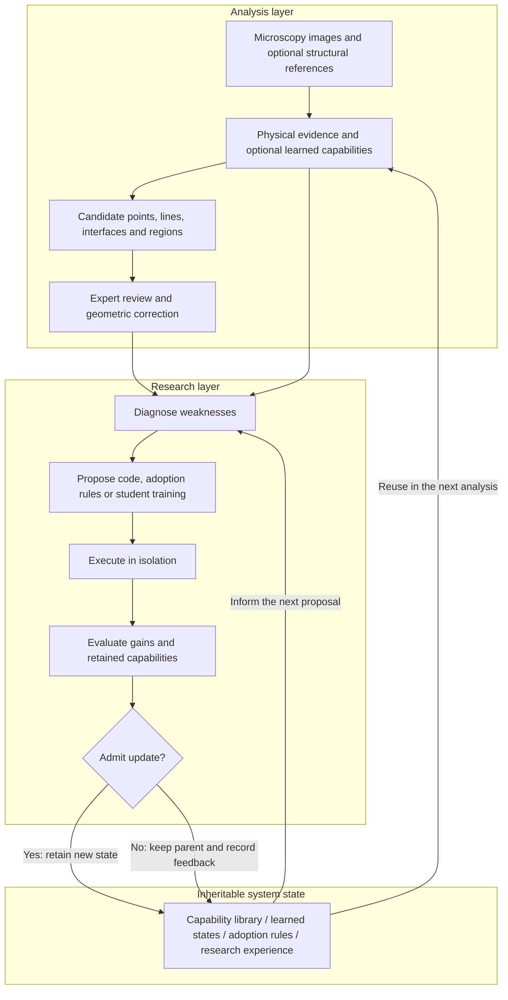

# PhyEvo-Mic-RSI

**English** | [简体中文](README.zh-CN.md)

### Turn each microscopy analysis into a starting point for the next improvement

**Physics-grounded recursive self-improvement for materials microscopy**

[Quick start](#quick-start) · [Framework](#framework) · [How RSI works](#how-rsi-works) · [Web workbench](#web-workbench) · [Documentation (Chinese)](docs/index_zh.md)

PhyEvo-Mic-RSI connects **physical analysis, expert feedback, student learning and executable research iterations**.
It identifies structural anomalies in microscopy images, organizes interpretable evidence,
and turns problems observed during analysis into executable improvement proposals.
Validated analysis capabilities, learned states and adoption rules are retained for subsequent analysis and research.

Our goal is to turn research experience into **reusable, composable and continually improvable computational capabilities**.

## Why PhyEvo-Mic-RSI?

Materials, imaging conditions and defect morphologies change.
Microscopy analysis often requires repeated inspection, parameter adjustments, tool selection and expert correction.
A correction may solve the current image without improving the tools used for the next similar case.

PhyEvo-Mic-RSI closes this loop:

- **Start from physical evidence.** Lattices, spectra, phase, symmetry and structural templates provide an analysis starting point that does not require supervised training.
- **Turn expert judgement into learning feedback.** Store geometric corrections, acceptance or rejection decisions and their provenance for student supervision and research diagnosis.
- **Make improvement executable.** RSI proposes analysis programs, training procedures or capability-adoption conditions, then evaluates them under a fixed protocol.
- **Retain useful experience.** New and existing capabilities form a callable library; later iterations can reuse and improve admitted states.

## Framework



[Original vector framework diagram (Chinese)](docs/assets/phyevo_mic_rsi_framework.svg) · [Current workflows and source entry points (Chinese)](docs/current_workflows_zh.md)

The **analysis layer** produces candidates and evidence from images.
The **research layer** proposes and tests improvements using feedback.
The **state layer** preserves capabilities and experience that later iterations can actually invoke.

Experts review difficult cases; students learn reusable image patterns; physical methods provide structural evidence.
RSI organizes how these capabilities are improved, combined and selected.

## How RSI works

Four components can evolve:

| System state | What is retained |
| --- | --- |
| Analysis capability library | Physical methods, generated analysis programs and composable branches |
| Student model state | Expert-supervised parameters and numerical states bound to executable programs |
| Capability-adoption rules | Observable conditions for invoking, retaining or combining a capability |
| Research experience | Proposals, execution feedback, acceptance/rejection records and parent–child lineage |

A research iteration follows six steps:

1. **Diagnose a problem.** Use development-side observations, branch disagreement, expert corrections and prior research records to identify a weakness.
2. **Propose a mechanism and an operation.** Generate executable code and adoption conditions: add a branch, improve a method, combine capabilities or train a student.
3. **Execute and collect feedback.** Run the candidate in isolation, recording inputs, code, parent state and training or inference artifacts.
4. **Evaluate the complete system.** Under the declared protocol and candidate budget, compare new gains, retention of existing capabilities and the actual composed result.
5. **Inherit or reject.** Admit validated capabilities and rules; otherwise retain the current system and record feedback for later research.
6. **Reuse the inherited state.** Later proposals can invoke the admitted program and numerical state as a parent capability.

Student training is one possible research operation, not the only form of improvement.
Programs, composition strategies and adoption conditions can also evolve.
Every candidate is evaluated; an iteration is not required to produce an accepted update.

The implementation starts in the [program-level RSI module](experiments/rsi_program_evolution_v1/README.md).
Core components include `composition_study`, `composition_runtime`, `controller`,
`retained_portfolio` and their evaluation and inheritance checks.

## What can it do?

| Analysis task | Main evidence | Main outputs |
| --- | --- | --- |
| Local amorphous and disordered regions | Spectra, autocorrelation, sharpness and structural coherence | Region candidates, continuous scores and diagnostic plots |
| Atomic-site anomalies | Atomic peaks, lattice registration, site presence and displacement residuals | Point candidates and per-site evidence |
| Stacking faults and phase lines | Multi-carrier phase, shear, rotation and curvature | Line candidates and local physical fields |
| Phase and domain boundaries | Local reciprocal-space signatures, domain partitioning and geometry | Interfaces and surrounding structural evidence |
| Symmetry anomalies | Multi-reference alignment and symmetry-group comparisons | Point, line, interface and region evidence |
| Structure-guided sites | CIF projections, structural registration and local model comparison | Template-related candidates and fit explanations |

Tasks share configuration, coordinates, candidate-evidence, review and evaluation interfaces.
With a scale calibration or reference structure, analysis can extend to local displacement,
lattice changes and two-dimensional projected strain.
Pretrained features, boundary refinement and expert-supervised students are optional capabilities;
the default physical analysis does not require downloading neural-network weights.

## From expert feedback to reusable capability

Researchers can accept, correct, reject or mark predictions as uncertain.
The platform saves decisions, geometry and version provenance.
Existing review records can be frozen, converted to supervision and grouped by acquisition source for training and evaluation;
experts do not need to repeat their annotations in every research iteration.

Students learn image and geometric patterns from expert corrections.
Physical branches, student branches and their combinations are compared separately.
Adoption rules use input evidence to select capabilities; RSI evaluates the resulting system to decide what to retain and reuse.

[Expert-supervised learning workflow (Chinese)](docs/expert_learning_cycle_zh.md) ·
[Evidence interface (Chinese)](docs/evidence_protocol_zh.md) ·
[Capability comparison and composition (Chinese)](docs/rsi_framework_zh.md)

## Web workbench

The platform includes a researcher-facing workbench, currently with a Chinese interface:

**Personal activation code → private project → image upload → background analysis → large-image review and geometric correction → saved feedback and export.**

- Each user has an independent identity and private projects. Designated experts gain access only after explicit authorization by the project owner.
- Review tools support zooming, panning, fullscreen viewing, comfortable display settings and point/line/region corrections. Saved reviews can be resumed.
- The original expert-review entry point and personal-project workbench remain separate; existing review data do not need to be migrated.
- The web interface manages analysis, feedback and research requests. Executable RSI and student training run through the configured research workflows.

[Deployment and use (Chinese)](docs/platform_zh.md) · [Expert-review quick guide (Chinese)](docs/expert_annotation_quick_guide_zh.md)

## Quick start

Requires **Python 3.10+**. Install in a dedicated project environment:

```bash
git clone https://github.com/yyt-2378/PhyEvo_Mic_STEM.git
cd PhyEvo_Mic_STEM
python -m venv .venv
source .venv/bin/activate
python -m pip install -e ".[dev]"
```

Run physical analysis on the example included in the repository:

```bash
python scripts/phyevo.py detect \
  --input reference_scale_radial_wiener.png \
  --config configs/amorphous.yaml \
  --output outputs/quickstart_amorphous
```

Analysis produces candidate overlays, continuous scores, diagnostic plots and structured results.
Use a new output directory for each run.

For the web and review interfaces:

```bash
python -m pip install -e ".[review,platform]"
python scripts/phyevo.py platform --help
python scripts/phyevo.py review --help
```

All primary workflows share one entry point:

| Workflow | Help command |
| --- | --- |
| Image detection | `python scripts/phyevo.py detect --help` |
| Expert review | `python scripts/phyevo.py review --help` |
| Private-project web workbench | `python scripts/phyevo.py platform --help` |
| Expert-supervised student training | `python scripts/phyevo.py train --help` |
| Program-level RSI | `python scripts/phyevo.py rsi --help` |
| Baselines and evaluation | `python scripts/phyevo.py benchmark --help` |
| Source validation | `python scripts/phyevo.py check --help` |

RSI research requires inputs, a parent system state, a development protocol and a run budget.
Specify their locations using the [`--run-config` template](configs/rsi_composition.example.json).
Model proposals enter through the `provider / broker` request–response interface.
See [current workflows (Chinese)](docs/current_workflows_zh.md) for the full procedure.

## Repository layout

```text
src/tfree_detection/                  Physical analysis, evidence, students, review and platform
experiments/rsi_program_evolution_v1/  Executable RSI, composition, inheritance and evaluation
apps/                                Web workbench and expert-review interfaces
scripts/phyevo.py                     Unified workflow entry point
configs/ and schemas/                Task/run configuration and data interfaces
tests/                               Synthetic, interface and regression tests
docs/                                User guides, framework descriptions and release documentation
```

`rsi_program_evolution_v1` is a compatibility-preserving module path containing the current
compositional-inheritance implementation; releases are pinned by Git commits.
Use the corresponding historical commit to reproduce older experiments and the unified entry point for routine work.

[Source layout (Chinese)](docs/repository_structure_zh.md) ·
[RSI module guide (Chinese)](experiments/rsi_program_evolution_v1/README.md) ·
[Documentation index (Chinese)](docs/index_zh.md)

## Validation and collaboration

Source validation is available without mounting real microscopy images, expert databases or experiment results:

```bash
python scripts/phyevo.py check --profile syntax
```

The core framework, RSI, expert review and web platform have distinct test scopes.
See the [release and validation guide (Chinese)](docs/publishing_zh.md) for isolated regression commands.
Research evaluation uses declared splits, candidate budgets and admission criteria;
programs and numerical states retain provenance and inheritance records.

Contributions are welcome for new materials, analysis tasks, physical criteria, student models and review workflows.
When reporting an issue, include the code version, task configuration and a shareable minimal example.
Provide full datasets and expert feedback only within their authorized scope.

**This repository publishes framework source, configuration, tests, essential documentation and lightweight architecture diagrams.**
Raw data, uploaded images, expert-review databases, model weights, complete experiment outputs,
analysis figure collections and manuscripts remain local and are not part of this source release.
The current package version is `0.4.0`.
