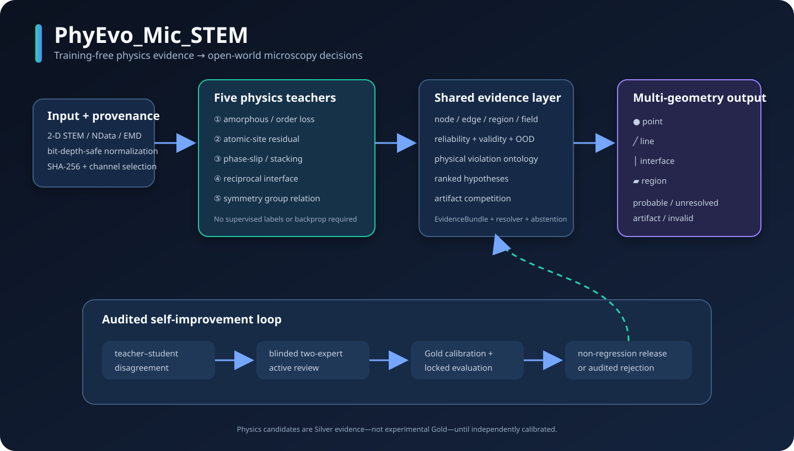

# PhyEvo_Mic_STEM / PhyEvo-Mic

**Training-free、物理证据驱动的原子分辨 STEM 开放世界缺陷分析平台。**

当前版本为 v0.4。冻结的 v0.2 training-free 检测器仍是独立 physics teacher；其上已经
搭建 EvidenceBundle v2、多假设 resolver、公开数据标签适配、数据治理、证据保持学生、
主动学习、专家共识、校准/OOD、反事实数字孪生和非退化发布门禁。



## 从这里开始

| 目标 | 文档 |
|---|---|
| 五分钟安装并跑通一张图 | [使用说明](docs/usage_zh.md) |
| 理解源码和目录边界 | [仓库结构](docs/repository_structure_zh.md) |
| 查看当前效果、指标与限制 | [结果总览](docs/results_summary_zh.md) |
| 使用物理约束 SAM 3 细化边界 | [SAM 3 边界细化](docs/sam3_boundary_refinement_zh.md) |
| 浏览全部研究文档 | [文档导航](docs/index_zh.md) |
| 了解公开范围与首次发布流程 | [发布说明](docs/publishing_zh.md) |
| 理解最新 Class1 群关系方法 | [Class1 最终报告](docs/class1_symmetry_relation_final_zh.md) |

仓库只跟踪源码、配置、测试、协议、轻量元数据和精选图示。原始数据、下载权重、完整运行
数组、审阅私钥及本地缓存均由 `.gitignore` 排除；它们仍保留在本地工作区，不会被删除。

## 当前可运行任务

| 任务 | 输出几何 | 主要物理证据 |
|---|---|---|
| `amorphous_region` | region | Fourier、Patterson、清晰度、可选 GPA/DINO/SAM 3 几何细化 |
| `atomic_point_defect` | point | 晶格配准、位点存在性/强度/位移残差 |
| `stacking_fault` | line | 双载波相位跳变、曲率、剪切/旋转 |
| `phase_boundary` | interface | 局部倒易签名分域与界面追踪 |
| `symmetry_relation` | region/interface/line/point | 多参考群对齐与五教师共识 |

```bash
python -m pip install -e ".[dev]"
pytest -q

tfree-detect detect \
  --input reference_scale_radial_wiener.png \
  --config configs/amorphous.yaml \
  --output outputs/quickstart_amorphous
```

核心链路是：

```text
physics teacher
      ↓  soft mask + node/edge/region/field evidence + reliability + provenance
optional guarded SAM 3
      ↓  boundary proposal OR deterministic coarse-mask fallback
multi-hypothesis resolver
      ↓  probable / artifact / unresolved + ranked alternatives
evidence-preserving student
      ↓  geometry + violation + evidence + reliability/OOD heads
teacher–student disagreement
      ↓  train-only active selection + two-expert review
Gold-only calibration + locked external evaluation
      ↓
non-regression release gate or audited rejection
```

当前状态必须分成两层理解：

- 软件闭环已实现，116 项自动测试通过，四任务冻结基准的 IoU/precision/recall 均保留
  100%；
- 新增的 WSe₂ train-domain 原子缺陷开发证据表明，互补双物理教师共识达到 site
  precision 0.8914、recall 0.6674、F1 0.7633；这 107 张图仍属于一个保守 train group，
  不是独立泛化结果；
- 投稿级真实证据尚未闭环：当前注册表中 `calibration=0`；一个 61 图、专家标注的
  III–V HRSTEM 归档已完成预注册零样本外测。结果显示任意缺陷 IoU 为 0.1396，当前解析
  教师的跨域迁移未达到可用水平；因此仍不能声称跨材料/跨实验室校准或持续精度提升。
- 第五个 `symmetry_relation` 任务已完成多参考群对齐、五教师与多几何输出。已消费
  Dennler Class1 上的事后 guided IoU/F1 为 `0.1891/0.3181`（历史
  `0.1251/0.2224`），但这不是新的独立外测。详见
  [`docs/class1_symmetry_relation_final_zh.md`](docs/class1_symmetry_relation_final_zh.md)。

完整状态、合成消融结果和真实实验缺口见
[`docs/implementation_status_zh.md`](docs/implementation_status_zh.md)；最初设计标准见
[`docs/self_improving_platform_roadmap_zh.md`](docs/self_improving_platform_roadmap_zh.md)。
锁定外测的预注册、唯一预测哈希和诚实负结果见
[`docs/locked_external_test_result_zh.md`](docs/locked_external_test_result_zh.md)。
可直接交给专家的 assisted/blinded 离线审阅界面和双人共识命令见
[`docs/expert_review_workflow_zh.md`](docs/expert_review_workflow_zh.md)。
周期反事实教师、双教师选择性共识、EMSeek 数据准入和全部开发域结果见
[`docs/periodic_counterfactual_and_consensus_zh.md`](docs/periodic_counterfactual_and_consensus_zh.md)。
公开数据第一波 sealed intake、标签适配、EvidenceBundle v2、多假设 resolver 和
NData/EMD 多帧读取见
[`docs/open_world_v0_4_implementation_zh.md`](docs/open_world_v0_4_implementation_zh.md)。
2026-07-27 的非人工环节收口、registry v3、逐样本 manifest、原子双教师正式入口和
SuperScan 时序证据见
[`docs/non_human_loop_completion_status_zh.md`](docs/non_human_loop_completion_status_zh.md)。

目前生产数据入口是
[`datasets/partition_registry_v6.yaml`](datasets/partition_registry_v6.yaml)，共 313 个
checksum 固定资产；对应的逐资产 shape/dtype/container/channel/selection 状态位于
[`datasets/standardized/sample_manifest_v7.jsonl`](datasets/standardized/sample_manifest_v7.jsonl)。
12 个已纳管数据集、23 个公开来源和统一 `tfree-data-interface-v1` 的完整汇总见
[`docs/data_collection_and_interface_standardization_zh.md`](docs/data_collection_and_interface_standardization_zh.md)。
最新加入的 NMC/LGPS、WSe₂ raw 1657、SrTiO₃、辐照 Al、聚合物 4D-STEM、容器清单和
training-free 实测见
[`docs/public_stem_dataset_expansion_2026_07_29_zh.md`](docs/public_stem_dataset_expansion_2026_07_29_zh.md)。

新增的可执行入口：

```bash
# 两个独立物理教师：共识候选为 Silver，单教师候选保留为 unresolved
python -m tfree_detection.cli detect-atomic-consensus \
  --input image.png --config configs/atomic_point_defect.yaml \
  --output outputs/atomic_consensus_run

# 对线或界面候选增加骨架、端点、分叉与线性度；不改变检测 mask
python -m tfree_detection.cli detect \
  --input image.tif --config configs/phase_boundary.yaml \
  --line-topology --output outputs/interface_topology_run

# 对 acquisition stack 增加漂移校正后的时间一致性；不自动删除候选
python -m tfree_detection.cli assess-temporal-support \
  --input movie.ndata1 --config configs/stacking_fault.yaml \
  --reference-frame-index 50 --max-frames 9 \
  --output outputs/temporal_support_run
```

这是一个面向原子分辨/高分辨显微图像的无标注、冻结权重检测框架。第一版按照
[`plan.md`](plan.md) 的核心原则实现：

> 不把自然图像大模型当作物理判据，而是先度量“正常周期结构能否解释局部观测”，
> 再用多个独立证据做鲁棒融合。

当前已经注册五个可运行的候选生成任务：局部非晶/失序、原子位点异常、相滑移线、
domain-signature 界面和群关系 Class1。它们共享输入、配置、结果、可视化和评估协议，
但使用不同物理证据。
任务分支不再直接决定最终物理亚型；resolver 会同时比较 vacancy/替位/位移、层错/位错/
弯曲、异相/孪晶以及失焦/相干性伪影，并允许输出 `artifact` 或 `unresolved`。

第二阶段已经实现：对第一阶段候选的核心、过渡环带和邻近正常参考带做几何相位分析
（GPA）与冻结 DINO ViT-S/8 特征验证。它可以在非晶核心无法定位清晰原子时，定量分析
周围晶格的相干度下降、拉伸、压缩和剪切关系。

SAM 3 物理约束边界层也已接入：主环境从 coarse mask 和物理分数生成正负点、box 与
coarse-mask prompts，隔离 Python 3.12 worker 返回候选级 proposal；某候选核心召回
低于 0.95 时只回退该候选。两相界面通过 domain A/domain B 两侧 region mask 重建共享
边界，不把界面当填充区域。组合几何已进入候选表、主报告、专家复核与边界评估。当前
v2 协议与 prepare-only 参考图已验证，但本机尚未执行授权 checkpoint 的真实 SAM
推理，详见
[`docs/sam3_boundary_refinement_zh.md`](docs/sam3_boundary_refinement_zh.md)。

## 多任务总览

| 任务名 | 检测对象 | training-free 主判据 |
|---|---|---|
| `amorphous_region` | 局部非晶、严重失序 | 频谱/Patterson/清晰度多证据；可选 GPA + 冻结 DINO |
| `atomic_point_defect` | 空位、低强度/置换、位移、间隙柱 | 原子峰定位、自动/给定子晶格、非刚性晶格配准、逐位点残差 |
| `stacking_fault` | 层错、部分位错、相位滑移线 | 两条倒易载波复解调、相位突变、曲率、剪切/旋转和相干度 |
| `phase_boundary` | 两相、孪晶、晶畴界面 | 局部极坐标 Fourier 签名、鲁棒双原型分域、界面追踪 |
| `symmetry_relation` | 平移/孪晶/镜像域、界面、相位线、芯点代理 | 多参考 motif 群对齐 + 五教师共识 + 四种几何 |

真实/公开案例已经整理成统一的[可视化总览](docs/assets/multitask_overview.png)；
颜色、轮廓、六面板详图和逐任务物理解释见
[`docs/visual_gallery_zh.md`](docs/visual_gallery_zh.md)。证据热图均以原子像为灰度底图做
半透明叠加，因此可以直接核对标量证据与真实原子相的位置关系。

这里的 training-free 指不使用监督标签、不反向传播或微调神经网络。各任务会在当前图像
上估计晶格、鲁棒中位数/MAD、非刚性漂移场或双域原型；这些属于每图统计适配，会明确
记录在元数据中，不能与“完全不做数值估计”混为一谈。

## Physics teacher 的检测结构

```text
原始 8/16/32-bit 图像
        │
        ▼
定量安全的百分位归一化（保留原始尺度元数据）
        │
        ▼
滑窗结构描述
  ├─ 局部 Fourier 熵、平坦度、峰集中度
  ├─ 全图倒易晶格峰的局部能量
  ├─ Patterson/自相关周期性
  └─ 标准化梯度清晰度
        │
        ▼
按正常多数假设做 median/MAD 鲁棒标准化
        │
        ▼
top-k 融合 + spectrum / Patterson / sharpness 独立证据组投票
        │
        ▼
边界质量控制 + 形态学 + 连通域
        │
        ▼
掩膜、连续分数、证据图、区域 JSON、可视化
```

没有使用人工标签、网络训练、PCA/OCSVM 拟合或生成式修复。全图自动估计的倒易峰只是
一个辅助分支；局部旋转或应变不会仅凭这一项被判为非晶。

## 快速运行

项目要求 Python 3.10+。当前环境已经以 editable 模式安装；在新环境中可执行：

```bash
python -m pip install -e .
```

对给定样例运行：

```bash
tfree-detect detect \
  --input reference_scale_radial_wiener.png \
  --config configs/amorphous.yaml \
  --output outputs/reference_amorphous
```

其他任务使用同一入口：

```bash
tfree-detect detect \
  --input atomic_image.tif \
  --config configs/atomic_point_defect.yaml \
  --skeleton schemas/skeleton.example.json \
  --output outputs/atomic_run

tfree-detect detect \
  --input stacking_fault.tif \
  --config configs/stacking_fault.yaml \
  --output outputs/stacking_run

tfree-detect detect \
  --input two_phase.tif \
  --config configs/phase_boundary.yaml \
  --output outputs/interface_run

tfree-detect detect \
  --input class1_image.tif \
  --config configs/symmetry_relation.yaml \
  --output outputs/symmetry_relation_run
```

点缺陷任务可以不提供骨架：系统会从 FFT 和观测峰的晶格分数坐标自动推断最多四个
子晶格。对于已知材料、低对称晶胞和元素特异性判定，仍应优先提供真实骨架。

也可以不安装命令行入口：

```bash
PYTHONPATH=src python -m tfree_detection detect \
  --input reference_scale_radial_wiener.png \
  --config configs/amorphous.yaml \
  --output outputs/reference_amorphous
```

Python API：

```python
from tfree_detection import TrainingFreeDetectionFramework, load_config

config = load_config("configs/amorphous.yaml")
framework = TrainingFreeDetectionFramework(config)
result = framework.detect("reference_scale_radial_wiener.png")

print(result.summary())
mask = result.mask
score = result.score_map
```

## 样例结果

在 `reference_scale_radial_wiener.png` 上，默认配置输出 3 个具有完整窗口上下文的内部
候选区域，总面积为 39,411 px（图像面积的 1.88%）：

| 区域 | bbox `(x1,y1,x2,y2)` | 面积/px | 置信值 | 证据 |
|---|---:|---:|---:|---|
| R1 | `(663,527,735,616)` | 4,706 | 0.579 | 频谱 + 清晰度 |
| R2 | `(178,678,357,881)` | 26,166 | 0.880 | 频谱 + 清晰度 |
| R3 | `(562,725,704,817)` | 8,539 | 0.622 | 频谱 + 清晰度 |

三处均为 `medium`，原因是频谱周期性下降和局部清晰度下降一致，但 Patterson 分支没有
同时越过独立证据阈值。因此它们应解释为“局部非晶候选”，不能在没有人工标注、原始
16-bit 数据或衍射/结构学复核的情况下当作确定真值。首轮出现的左下边界候选因窗口
上下文不完整，已被 `exclude_border_touching` 质量规则排除。

直接查看：

- [候选叠加图](outputs/reference_amorphous/overlay.png)
- [连续分数图](outputs/reference_amorphous/score_heatmap.png)
- [各证据诊断图](outputs/reference_amorphous/diagnostics.png)
- [区域与运行元数据](outputs/reference_amorphous/summary.json)

## 第二阶段：周围晶格拉伸和 DINO 验证

安装第二阶段依赖并下载官方 DINO ViT-S/8 权重：

```bash
python -m pip install -e ".[stage2]"
python scripts/download_dino_weights.py
```

下载器使用分段续传，最终 checkpoint 大小为 86,728,949 bytes。本次验证文件的
SHA-256 为：

```text
55c8b267f479b614ec20858947ce361ba804846c193e20be74263a096bb6d75e
```

运行完整两阶段流程：

```bash
tfree-detect detect \
  --input reference_scale_radial_wiener.png \
  --config configs/amorphous_stage2.yaml \
  --output outputs/my_stage2_run
```

### 几何相位分析

系统从最强的两条独立倒易晶格峰 \(g_1,g_2\) 构造复数晶格波。为避免非晶核心中的
二维相位展开失败，直接使用复数相位梯度：

\[
\nabla\phi =
\frac{\operatorname{Im}(z^*\nabla z)}
{|z|^2+\epsilon}
\]

随后求解：

\[
\nabla\phi_i=-2\pi g_i^\top\nabla u
\]

得到位移梯度、法向应变 \(\epsilon_{xx},\epsilon_{yy}\)、剪切
\(\epsilon_{xy}\)、主拉伸应变以及沿两个晶格基矢的相对距离变化。当前图像估计的两条
直接晶格基矢长度约为 27.21 px 和 28.06 px。

区域按距非晶候选边界的距离划分：

- 核心：第一阶段掩膜内部；
- 过渡带：距核心 12–90 px；
- 正常参考带：距核心 110–190 px；
- 相干度低于 0.65 的像素不用于应变统计；
- 外围 64 px 因 Fourier 空间支持不完整而标为无效。

### 冻结 DINO 验证

每个区域分别从核心、过渡带和正常参考带抽取 16 个 128×128 显微 patch，缩放到
224×224 后输入冻结 DINO ViT-S/8。以局部正常参考 embedding 的中位原型为基准，比较
余弦距离。这里没有反向传播、微调或分类器拟合。

真实样例的第二阶段结果：

| 区域 | 综合支持 | 核心晶格相干度损失 | 过渡带应变 P90 / 参考 P90 | 主拉伸中位数 / P90 | DINO 核心 z |
|---|---|---:|---:|---:|---:|
| R1 | strong | 27.2% | 1.425× | 3.40% / 6.72% | 3.60 |
| R2 | moderate | 36.0% | 1.238× | 1.49% / 4.86% | 7.13 |
| R3 | strong | 28.6% | 1.376× | 2.50% / 5.89% | 2.81 |

解释上：

- R1、R3 同时出现明显相干度下降、过渡带应变富集和 DINO 特征偏离；
- R2 的 DINO 核心异常最强、相干度损失最大，但过渡带应变富集略低于强支持门槛
  1.25，因此综合标为 `moderate`；
- 这些应变是相对于全图主晶格的二维投影应变，不等同于经过像素标尺校准的真实长度，
  也不能消除厚度、扫描畸变和样品倾斜的影响。

第二阶段产物：

- [GPA 应变和晶格相干度诊断图](outputs/reference_amorphous_stage2_final/stage2_diagnostics.png)
- [候选周围形变叠加图](outputs/reference_amorphous_stage2_final/strain_overlay.png)
- [第二阶段定量 JSON](outputs/reference_amorphous_stage2_final/stage2_summary.json)
- [包含全部阶段的结果 JSON](outputs/reference_amorphous_stage2_final/summary.json)

## 输出协议

每次运行会生成：

| 文件 | 用途 |
|---|---|
| `summary.json` | 区域 bbox、质心、面积、置信度、证据组及完整运行元数据 |
| `config_resolved.yaml` | 实际使用的全部参数 |
| `overlay.png` | 原图、掩膜轮廓和区域编号 |
| `score_heatmap.png` | 未阈值化的连续异常分数 |
| `diagnostics.png` | 频谱、Patterson、清晰度三组证据 |
| `mask.png` / `mask.npy` | 二值候选区域 |
| `score_map.npy` | 可供后续定量分析的 float32 分数 |
| `feature_maps.npz` | 所有可解释底层特征 |
| `evidence_maps.npz` | 分组证据与支持数 |
| `evidence_protocol.json` | 节点—边—区域—场证据、可靠性、多假设及 provenance |
| `candidate_table.jsonl` | 不可静默覆盖的候选级数据表 |
| `reliability_map.npy` | 与置信分数分离的物理测量可靠性 |
| `decision_map.npy` | background/confirmed/uncertain/OOD/invalid/artifact/unresolved 状态编码 |
| `hypothesis_maps.npz` | 多个稀疏、可审计 hypothesis energy |
| `evidence_reliability_maps.npz` | 每一项证据各自的可靠性 |

统一协议的物理定义、标签等级和状态语义见
[`docs/evidence_protocol_zh.md`](docs/evidence_protocol_zh.md)。
真实分子筛样例的可靠性、拒答状态与统一能量叠加图见
[`evidence_protocol_diagnostics.png`](outputs/reference_amorphous_v03_evidence_v2/evidence_protocol_diagnostics.png)；
四个面板均保留原子相作为底图。

## 自提升层

### 数据与 Gold 治理

当前真实数据注册表是
[`datasets/partition_registry_v2.yaml`](datasets/partition_registry_v2.yaml)。同一
`split_group_id` 不能跨 train/calibration/development/locked 分区，只有 train 能进入
主动学习。v1
[`partition_registry.yaml`](datasets/partition_registry.yaml) 已被 Dennler 预注册 seal
冻结，保留用于复核该次外测，不能原地修改。物理教师不能创建 Gold，已有 Gold 不能被
Silver 覆盖。

外部数据先经过独立 intake plan：source revision、license、group provenance、文件/配对
哈希和标注资质必须先封存，才可以生成新版本 registry。当前 EMSeek WSe₂ 子集有 107 张
图像和 107 张作者标注，因 acquisition 信息不足全部放进一个保守 train group；标注公开
reviewer 数未知，所以是 `author_curated`，不是 Gold。220 个当前注册资产中，
`train=215`、`development_test=4`、`locked_external_test=1`、`calibration=0`，仅 107
个原始图像允许进入主动学习。

v0.4 另有三个尚未 merge 进生产 registry 的 sealed plan：

- EMSeek 剩余 16 个科学子集：固定 28,334 个远程 LFS SHA-256，4.20 GB 尚未批量下载；
- Guo SuperScan：100 帧 acquisition，本地 MD5 + SHA-256 已验证；
- Al Σ3：两个 STEM orientation、EBSD、simulation 和 README 分五组，本地 SHA-256 已验证。

后两者是 `development_candidate`，不能训练或主动学习；EMSeek 只有在全部所选文件通过
`--verify-files` 后才能 admit。

```bash
PYTHONPATH=src python scripts/manage_data_intake.py verify \
  --plan datasets/intake/emseek_wse2_train_v1.sealed.yaml \
  --verify-files

PYTHONPATH=src python -m tfree_detection validate-registry \
  --registry datasets/partition_registry_v2.yaml \
  --project-root .
```

详细协议见
[`docs/data_governance_and_calibration_zh.md`](docs/data_governance_and_calibration_zh.md)。

### 原子点缺陷：周期反事实与双物理教师

新增教师直接检查晶格平移不变性：

\[
S(x)=G_{\tau}*\min_{v\in\{\pm a,\pm b,\pm(b-a)\}}
\left|G_{\sigma}*I(x)-G_{\sigma}*I(x+v)\right|.
\]

最小值聚合要求候选同时违反多个周期对应位置，降低“单个坏邻居”带来的假阳性。它与
v0.2 亮原子位点配准教师按 `site_matching_v2` 做一对一共识：先最大化容差内匹配数，再
最小化定位误差；共识点是 Silver，单教师点全部进入 Unresolved 审阅池。

同一个 WSe₂ train group 的 micro site 结果为：

| 分支 | Precision | Recall | F1 |
|---|---:|---:|---:|
| v0.2 位点配准，高召回 | 0.4895 | 0.9226 | 0.6396 |
| 周期反事实，高精度 | 0.7367 | 0.6874 | 0.7112 |
| 双教师共识 v2 | 0.8914 | 0.6674 | 0.7633 |

这是开发域互补性证据，不是跨材料 benchmark。双教师确认层只覆盖联合候选池的 0.3618，
selective risk 为 0.1086；另外 21,169 个教师不一致点保留为主动审阅池。可视化见
[教师汇总图](benchmarks/development_runs/emseek_wse2_two_teacher_consensus_v2_score/teacher_consensus_summary_final.png)
和
[代表性原子图叠加](benchmarks/development_runs/emseek_wse2_two_teacher_consensus_v2_score/teacher_consensus_overlay_image23_final.png)。

### Evidence-preserving student

学生是共享编码器与多头解码器，预测：

- point / line / region / interface 几何；
- occupancy / displacement / phase-slip / coherence-loss 等违反类型；
- 统一物理证据；
- reliability 和 OOD。

它同时学习可靠 Silver、低权重 Unresolved 和高可靠正常区域。硬伪标签对照只学习阈值后二值
掩膜。确定性合成消融使用相同初始化、相同网络和相同反事实数据：

| 模型 | IoU | Precision | Recall |
|---|---:|---:|---:|
| Evidence-preserving student | 0.665 | 0.791 | 0.806 |
| Hard-pseudolabel student | 0.604 | 0.627 | 0.942 |

证据学生 IoU 高 0.061，主要降低假阳性。这个结果只覆盖未见旋转/噪声的合成条件，不是未见
材料结论；前两次负结果也保存在
[`student_ablation_history.json`](benchmarks/student_ablation_history.json)。

复现：

```bash
PYTHONPATH=src python benchmarks/run_student_ablation.py
```

### 主动学习与专家复核

候选排序同时使用学生不确定性、teacher–student disagreement、OOD、embedding 多样性、
物理违反和预计标注时间。calibration、development 和 locked 候选会被排除。复核协议支持
接受/拒绝、未知、伪影、改类型、点/线/轮廓修正；只有两位独立专家一致时才转成 Gold。

一个 WSe₂ 前瞻 pilot 包已经从 69 张 train 图中 label-blind 地封存 100 个候选：共识、
periodic-only、legacy-only 和 random sham prompt 各 25 个，并生成 assisted/blinded
多图 HTML。当前没有收到专家 response，所以这是“可执行实验已准备”，不是 pilot 已完成。
入口、私有 key 隔离和 reviewer 分配要求见
[`docs/expert_review_workflow_zh.md`](docs/expert_review_workflow_zh.md)。

另一条面向当前公开二维 STEM 数据的在线流程已可运行：已有像素标签的 200 张只进入自动
评测；354 个无标签图像平面合并为 154 个专家病例（train 131 / validation 23）。Streamlit
并排显示原图与预计算 training-free 预测，支持接受、修正、拒绝、无缺陷、artifact 和
unknown；SQLite 保存一个当前结果和完整不可变历史，刷新后可续审。启动与导出见
[`docs/expert_review_platform_2d_zh.md`](docs/expert_review_platform_2d_zh.md)。当前正式账本为空，
因此这里声明的是“平台已验证”，不是“专家标注已经完成”。

### 校准、OOD 与发布

平台已提供：

- temperature scaling 与 PAVA isotonic calibration；
- Brier、ECE、risk–coverage；
- split conformal binary prediction sets；
- shrinkage Mahalanobis OOD 与 AUROC/AUPR；
- data/model/domain 三类不确定性分离；
- accuracy、calibration、risk、OOD 和 locked-test hash 的联合发布门禁。

这些接口会强制 Gold-only calibration。当前 calibration 分区为空，所以本 README 不报告
真实概率或 conformal 覆盖。

### 反事实数字孪生

四任务都有 normal/defect 同 nuisance 配对生成器：两张图共享角度、照明、模糊、剂量参数和
耦合随机成像实现，只改变结构干预。当前是用于软件消融的解析纹理生成器，尚不是经过真实
STEM 成像参数验证的 multislice 模拟器。

### 路线图审计

```bash
PYTHONPATH=src python scripts/check_baseline_regression.py
PYTHONPATH=src python scripts/audit_roadmap_status.py
```

第一个命令检查每个旧任务至少保留 95% 性能；第二个命令把“代码已实现”和“真实科学证据
已完成”分开列出。

## 参数如何调整

核心配置在 [`configs/amorphous.yaml`](configs/amorphous.yaml)。

| 参数 | 含义 | 调整建议 |
|---|---|---|
| `patch_size` | 局部结构窗口 | 建议覆盖 5–10 个晶格周期；越大越稳但边界越粗 |
| `stride` | 分数采样步长 | 越小轮廓越细、计算越慢 |
| `min/max_frequency` | 分析频带，单位 cycles/pixel | 覆盖主要倒易晶格峰，排除背景和像素噪声 |
| `threshold_quantile` | 候选上尾门槛 | 提高可减少候选 |
| `support_z` | 单证据组支持门槛 | 提高可要求更强证据 |
| `minimum_evidence_groups` | 独立证据一致性 | 默认 2；设为 3 更保守 |
| `minimum_region_area` | 最小连通域面积 | 根据最小有物理意义的非晶区域调整 |
| `exclude_border_touching` | 排除上下文不完整区域 | 定量分析建议保持 `true` |

第二阶段主要参数位于 `stage2.phase` 和 `stage2.dino`：

| 参数 | 含义 |
|---|---|
| `frequency_filter_sigma` | GPA 倒易峰 Gaussian 频域带宽 |
| `minimum_coherence` | 参与应变统计的最低晶格相干度 |
| `transition_*_radius` | 非晶—晶体过渡环带 |
| `reference_*_radius` | 每个候选的局部正常参考环带 |
| `microscopy_patch_size` | DINO 看到的显微局部上下文 |
| `samples_per_zone` | 核心、过渡带、参考带各自采样数 |

置信值是基于本图鲁棒统计的相对证据，不是经过标注校准的概率。

## 骨架和缺陷示例接口

框架入口已接受可选结构先验：

```bash
tfree-detect detect \
  --input image.tif \
  --skeleton schemas/skeleton.example.json \
  --exemplar defect_crop.tif \
  --output outputs/run
```

骨架协议包含二维基矢、节点、子晶格、预期元素/相对强度、可选节点和配位边，示例见
[`schemas/skeleton.example.json`](schemas/skeleton.example.json)。当前
`amorphous_region`、`stacking_fault` 和 `phase_boundary` 不强制依赖骨架。
`atomic_point_defect` 会实际读取骨架的像素基矢、必需节点、子晶格名称和相对强度；
没有骨架时才退回自动子晶格推断。新任务仍可在 `src/tfree_detection/tasks/` 中注册
`DetectionTask`，复用现有预处理、结果协议、报告和 CLI。

DINO 是可选第二阶段验证分支，不是基础检测的强制依赖。SAM 更适合在已有连续热图和
物理候选后细化轮廓，但本样例没有清晰可分割的“非晶对象”，因此当前没有用 SAM 掩膜
改变物理结论。这样可以避免提示诱导的掩膜取代结构判据。

## 公开实验数据

已接入 Guo 等人随论文公开的原子分辨数据，数据 DOI 为
[`10.5281/zenodo.5520169`](https://doi.org/10.5281/zenodo.5520169)，许可证为
CC BY 4.0。论文展示了 MoWTe₂ 点/线缺陷、模拟 Al 部分位错以及 ZrO₂ 孪晶界面：
[`10.1038/s41524-021-00642-1`](https://doi.org/10.1038/s41524-021-00642-1)。

下载器不会覆盖已有数据，并同时检查精确字节数和 MD5：

```bash
python scripts/fetch_public_dataset.py \
  --dataset guo_2021_atomic_defects
```

公开数据的来源、文件名、任务映射、许可证和校验值见
[`datasets/manifest.yaml`](datasets/manifest.yaml)。运行可重复的公开数据检查：

```bash
PYTHONPATH=src python benchmarks/run_public_benchmark.py
```

当前校验结果：

| 图像/任务 | 结果 |
|---|---|
| MoWTe₂ 点缺陷 | 自动识别 2 个子晶格；4674 个预期位点中保留 205 个可靠候选（4.39%） |
| 模拟 Al 层错/部分位错 | 收敛为 2 个主要相位突变核心，边缘 Fourier 无效区为 80 px |
| ZrO₂ 孪晶界面 | 自动屏蔽真空背景，得到 1 条内部两域界面；域面积约 26.8% / 73.1% |

最终叠加图：

- [MoWTe₂ 原子点缺陷候选](outputs/public_mowte2_atomic_defects_final_v2/overlay.png)
- [Al 层错/部分位错相位突变](outputs/public_al_stacking_fault_final_v2/overlay.png)
- [ZrO₂ 内部两域界面](outputs/public_zro2_phase_boundary_final_v2/overlay.png)

该公开档案没有穷尽式机器可读像素真值，因此这里只报告校验、可重复性和定性结构一致性，
不把论文图中肉眼标记伪装成像素准确率。结果快照见
[`benchmarks/latest_public_results.json`](benchmarks/latest_public_results.json)。

## 普适性测试

运行单元和端到端测试（存在本地 checkpoint 时也会验证冻结 DINO 前向）：

```bash
mkdir -p .codex-tmp
PYTHONPATH=src pytest --basetemp .codex-tmp/pytest-manual-run
```

运行旋转/噪声合成基准：

```bash
python benchmarks/run_synthetic_benchmark.py
```

基准生成同一物理异常，但改变晶格方向和噪声；它不参与任何阈值训练。当前三组结果：

| 晶格方向 | 噪声标准差 | IoU | Precision | Recall |
|---:|---:|---:|---:|---:|
| 0° | 0.08 | 0.647 | 0.647 | 1.000 |
| 17° | 0.10 | 0.784 | 0.796 | 0.981 |
| 33° | 0.14 | 0.834 | 0.862 | 0.963 |

平均 IoU 为 0.755。测试还覆盖强度仿射变换不变性、错误配置失败、输出协议完整性以及
旋转晶格中的定位能力。

四任务统一合成基准使用确定性生成器和精确真值掩膜：

```bash
PYTHONPATH=src python benchmarks/run_multitask_benchmark.py
```

| 任务 | IoU | Precision | Recall |
|---|---:|---:|---:|
| 局部非晶 | 0.861 | 0.883 | 0.971 |
| 原子点缺陷 | 0.674 | 1.000 | 0.674 |
| 层错/相位滑移 | 0.591 | 0.797 | 0.695 |
| 两相界面 | 0.474 | 0.795 | 0.540 |

四任务平均 IoU 为 0.650。界面定位受局部 FFT 窗口宽度限制，像素边缘不会像逐像素监督
分割一样锐利。完整快照见
[`benchmarks/latest_multitask_results.json`](benchmarks/latest_multitask_results.json)。

## 当前边界

- 默认采用“正常结构占多数”的鲁棒统计假设；大面积相变应改成多骨架竞争任务。
- 8-bit PNG 已丢失部分定量信息。若有未压缩 16-bit/32-bit 原图，应优先使用原图。
- 局部失焦、扫描漂移和真实非晶都可能降低周期性；所以框架保留证据图与中等置信标签，
  不用单一阈值声称材料结论。
- 当前输出的空间分辨率由 `patch_size` 决定，不等同于逐原子分割。
- GPA 在晶格相干度很低的非晶核心内不解释原子位移，只在可靠核心像素及周围晶体环带
  统计应变；这正是第二阶段使用环带而不是强行找原子的原因。
- 当前 DINO 是自然图像预训练的冻结 ViT-S/8，只能提供纹理偏离证据，不能单独证明
  非晶或给出材料学类别。
- 自动点缺陷模式能够推断常见多子晶格，但低对称、大晶胞和元素特异性分类仍应提供
  真实骨架；“低强度柱”不能只凭单幅 HAADF 图无条件等同于某一种化学空位。
- 层错任务检测的是相位滑移与位错核心的候选证据；厚度变化、扫描跳变和强弯曲也会产生
  相似信号，应结合原始采集元数据复核。
- 两相任务输出的是当前图像中的域编号，不是化学相名称；真空/颗粒表面通过局部晶体
  对比度屏蔽，域原型仍需要衍射、成分或结构模型才能赋予材料学标签。
