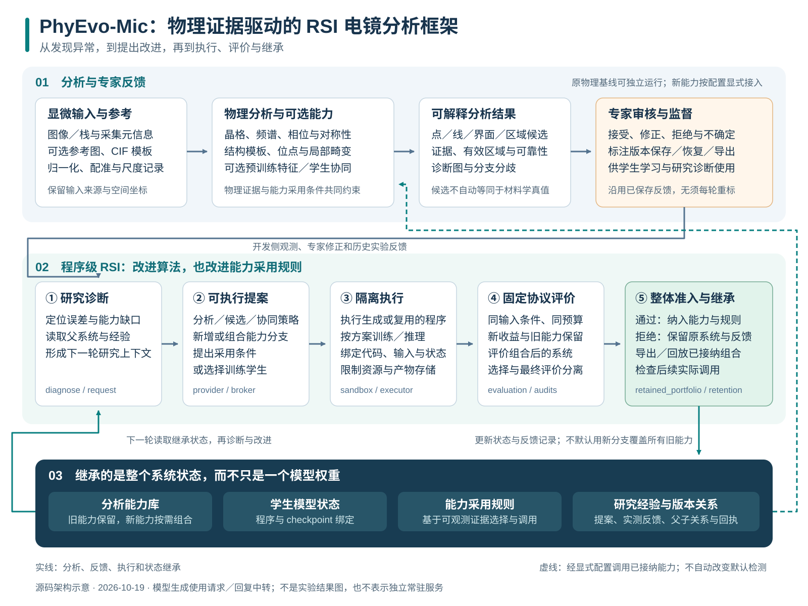

# PhyEvo-Mic-RSI

[English](README.md) | **简体中文**

### 让每一次电镜分析，都成为下一次能力改进的起点

**面向材料电镜的物理证据驱动递归自改进平台**

*Physics-grounded recursive self-improvement for microscopy.*

[快速开始](#快速开始) · [整体框架](#整体框架) · [RSI 如何工作](#rsi-如何工作) · [网页工作台](#网页工作台) · [使用文档](docs/index_zh.md)

PhyEvo-Mic-RSI 将**物理分析、专家反馈、学生学习与可执行研究迭代**连接起来：
从显微图像中定位结构异常，组织可解释证据，再将分析中暴露的问题转化为可执行的改进方案。
通过评价的分析能力、模型状态和采用规则会被保存，并在后续分析与研究中继续调用。

我们的目标，是让材料研究中的分析经验能够沉淀为**可复用、可组合、可继续改进的计算能力**。

## 为什么需要 PhyEvo-Mic-RSI？

材料、成像条件和缺陷形态不断变化，电镜分析往往需要研究者反复观察、调整参数、选择工具与修正结果。
一次修正解决了当前图像的问题，却未必能让分析工具在下一次遇到相似情况时做得更好。

PhyEvo-Mic-RSI 围绕这一过程建立闭环：

- **从物理证据开始。** 用晶格、频谱、相位、对称性和结构模板定位异常，建立无需监督训练即可运行的分析起点。
- **把专家判断转化为可学习反馈。** 保存几何修正、接受或拒绝意见及其来源，为学生模型与研究诊断提供监督。
- **让改进成为可执行的研究过程。** RSI 提出分析程序、训练方案或能力采用条件，执行后按固定协议决定是否纳入系统。
- **把有效经验留在框架里。** 新能力与已有能力共同组成可调用的能力库，后续迭代可以使用并改进已接纳的状态。

## 整体框架



[打开高清矢量框架图](docs/assets/phyevo_mic_rsi_framework.svg) · [当前工作流与源码入口](docs/current_workflows_zh.md)

框架分为三个相互连接的部分：**分析层**从图像生成候选与证据，
**研究层**依据反馈提出并验证改进，**状态层**保存可供下一轮实际调用的能力与经验。
专家参与困难样本判断，学生模型沉淀可学习的图像规律，物理分析提供结构依据，
RSI 则负责组织这些能力的改进、组合和选择。

## RSI 如何工作？

PhyEvo-Mic-RSI 的改进对象包含四部分：

| 系统状态 | 保存的能力 |
| --- | --- |
| 分析能力库 | 物理方法、生成的分析程序及可组合的分支 |
| 学生模型状态 | 由专家监督学习得到的参数及与程序绑定的数值状态 |
| 能力采用规则 | 根据可观测证据决定何时调用、保留或组合某项能力 |
| 研究经验 | 提案、执行反馈、接受／拒绝记录和版本父子关系 |

一次研究迭代沿着以下过程推进：

1. **发现问题。** 读取开发侧观测、分支分歧、专家修正和已有研究记录，定位当前分析的不足。
2. **提出机制与操作。** 形成可执行程序与采用条件，选择新增分支、改进方法、组合能力或训练学生。
3. **执行并得到反馈。** 在隔离环境中运行候选程序，记录输入、代码、父状态、训练或推理产物。
4. **评价整个系统。** 在声明的协议和候选预算下，比较新收益、已有能力保留及实际组合结果。
5. **继承或拒绝。** 通过准入则保存能力与调用规则；未通过则保留当前系统，并将反馈用于后续研究。
6. **下一轮实际复用。** 已接纳节点的程序和数值状态成为后续候选可以调用的父能力，形成连续迭代。

学生训练是其中一种研究操作；程序、组合方式与采用条件也可以成为改进对象。
框架对每一次候选分别评价，而不是预设每一轮都必须接受更新。

实现入口为 [程序级 RSI 模块](experiments/rsi_program_evolution_v1/README.md)，
核心组件包括 `composition_study`、`composition_runtime`、`controller`、
`retained_portfolio` 和相应的评价／继承检查模块。

## 可以用它做什么？

| 分析任务 | 主要依据 | 主要输出 |
| --- | --- | --- |
| 局部非晶与失序区域 | 频谱、自相关、清晰度与结构相干性 | 区域候选、连续分数和诊断图 |
| 原子位点异常 | 原子峰、晶格配准、位点存在性与位移残差 | 点位候选及逐位点证据 |
| 层错与相位线 | 多载波相位、剪切、旋转与曲率 | 线状候选与局部物理场 |
| 相界与晶畴边界 | 局部倒易签名、分域和几何关系 | 界面及邻域结构证据 |
| 对称关系异常 | 多参考结构对齐与群关系比较 | 点、线、界面和区域证据 |
| 结构模板引导位点 | CIF 投影、结构配准与局部模型比较 | 模板相关候选和拟合解释 |

这些任务共享配置、坐标、候选证据、审核与评估接口。
有标尺或参考结构时，可进一步开展局部位移、晶格变化和二维投影应变分析。
预训练特征、边界细化和专家监督学生作为可选能力接入；默认物理分析无需下载神经网络权重。

## 专家反馈怎样沉淀为分析能力？

研究者可以对预测进行接受、修正、拒绝或不确定判断，平台保存意见、几何和版本来源。
已有审核记录能够被封存、转换为监督并按采集来源组织训练与评价，无须在每轮研究中重复标注。

学生模型学习专家修正所包含的图像与几何规律；物理分支、学生分支及其组合分别参与比较。
采用规则依据输入证据决定调用方式，RSI 再通过系统级评价判断如何保留和使用新能力。

[专家监督学习流程](docs/expert_learning_cycle_zh.md) ·
[证据接口](docs/evidence_protocol_zh.md) ·
[能力比较与协同评价](docs/rsi_framework_zh.md)

## 网页工作台

平台提供面向研究者的中文工作台：

**个人激活码 → 私有项目 → 上传图像 → 后台分析 → 大图查看与几何修正 → 保存反馈与导出。**

- 每位用户拥有独立身份与私有项目，项目所有者明确授权后，指定专家才能访问。
- 支持缩放、拖动、全屏、柔和显示以及点／线／区域修正，保存后可恢复自己的审核记录。
- 原专家审核入口与个人项目工作台分别保留，已有审核数据不需要迁移。
- 网页提供分析、反馈和研究请求管理；可执行 RSI 与学生训练由研究入口按配置运行。

[网页部署与使用](docs/platform_zh.md) · [专家审核操作指南](docs/expert_annotation_quick_guide_zh.md)

## 快速开始

要求 **Python 3.10+**。在项目独立环境中安装：

```bash
git clone https://github.com/yyt-2378/PhyEvo_Mic_STEM.git
cd PhyEvo_Mic_STEM
python -m venv .venv
source .venv/bin/activate
python -m pip install -e ".[dev]"
```

使用仓库已有的示例运行物理分析：

```bash
python scripts/phyevo.py detect \
  --input reference_scale_radial_wiener.png \
  --config configs/amorphous.yaml \
  --output outputs/quickstart_amorphous
```

分析会生成候选叠加图、连续分数、诊断图和结构化结果。每次使用新的输出目录。

需要网页与审核功能时：

```bash
python -m pip install -e ".[review,platform]"
python scripts/phyevo.py platform --help
python scripts/phyevo.py review --help
```

所有主要工作流都从同一个入口进入：

| 目的 | 查看命令 |
| --- | --- |
| 原图检测 | `python scripts/phyevo.py detect --help` |
| 专家审核 | `python scripts/phyevo.py review --help` |
| 私有项目网页工作台 | `python scripts/phyevo.py platform --help` |
| 专家监督学生训练 | `python scripts/phyevo.py train --help` |
| 程序级 RSI | `python scripts/phyevo.py rsi --help` |
| 基线与评测 | `python scripts/phyevo.py benchmark --help` |
| 源码验收 | `python scripts/phyevo.py check --help` |

RSI 研究需要准备输入、父系统状态、开发协议和运行预算，并通过
[`--run-config` 模板](configs/rsi_composition.example.json) 指定位置。
模型提案通过 `provider / broker` 请求与回复接口接入；完整步骤见
[当前工作流](docs/current_workflows_zh.md)。

## 项目结构

```text
src/tfree_detection/                  物理分析、证据、学生、审核与平台
experiments/rsi_program_evolution_v1/  可执行 RSI、能力组合、状态继承与评价
apps/                                网页工作台和专家审核界面
scripts/phyevo.py                     统一工作流入口
configs/ · schemas/                  任务配置、运行配置和数据接口
tests/                               合成测试、接口与回归验证
docs/                                使用指南、框架说明和发布文档
```

`rsi_program_evolution_v1` 是兼容保留的模块路径，包含当前组合继承实现；发布版本由 Git 提交固定。
旧实验使用对应历史提交复现，日常使用从统一入口开始。

[源码结构](docs/repository_structure_zh.md) ·
[RSI 模块说明](experiments/rsi_program_evolution_v1/README.md) ·
[完整文档导航](docs/index_zh.md)

## 验证与协作

项目提供不挂载真实原图、专家数据库或实验结果的源码验证：

```bash
python scripts/phyevo.py check --profile syntax
```

核心框架、RSI、专家审核和网页平台分别有明确的测试范围；隔离回归环境与命令见
[发布与验证说明](docs/publishing_zh.md)。
研究评价使用声明的数据划分、候选预算和准入规则，程序与状态记录其来源和继承关系。

欢迎围绕新的材料场景、分析任务、物理判据、学生模型和审核体验开展协作。
提出问题时，请附上代码版本、任务配置和可共享的最小示例；完整数据与专家意见应按其授权范围提供。

**此仓库发布框架源码、配置、测试、必要文档与轻量架构示意图。**
原始数据、用户上传图像、专家审核库、模型权重、完整实验输出、分析图集与稿件保存在本地，
不随本次代码发布上传。当前包版本为 `0.4.0`。
