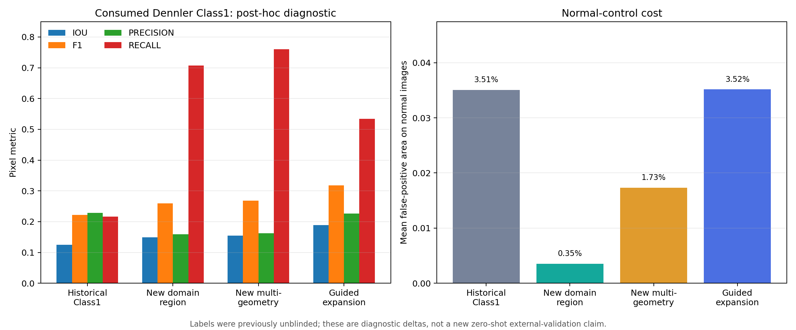
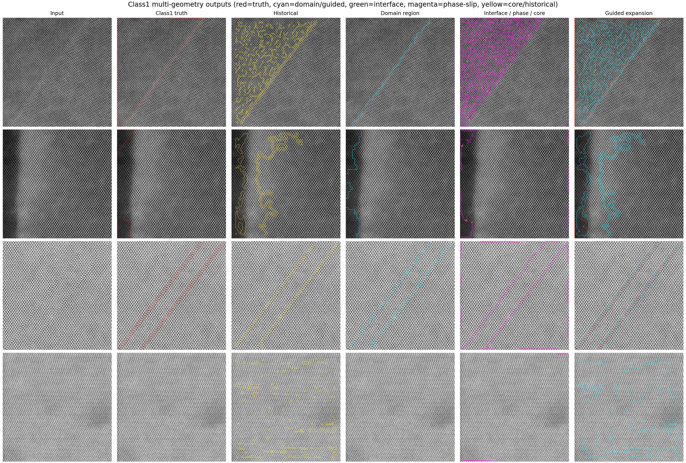

# Class1 群关系检测最终实现与 Dennler 事后诊断

> 实现版本：`class1-final-v1`（端点语义修复后的 v2 产物）  
> 日期：2026-07-28  
> 科学状态：**已揭盲 Dennler 上的 post-hoc diagnostic，不是新的独立外测**

## 结论

Class1 已从旧版“相位线 + 倒易纹理边界的保守并集”升级为一个独立的
`symmetry_relation` 任务。它不再把所有 secondary symmetry 都压成 box 或单一粗掩膜，
而是输出四种几何：

1. `symmetry_domain_region`：平移、旋转、镜像或子晶格交换相关的晶域区域；
2. `interface_line`：获得位移不连续支持的晶域界面线；
3. `phase_slip_line`：独立相位滑移/层错线；
4. `dislocation_core_point`：相位线内部端点附近的 Burgers-loop 不闭合代理点。

Dennler 61 图事后重测 61/61 成功。相对历史 Class1：

| 输出策略 | IoU | Precision | Recall | F1 | 正常图平均误报面积 |
|---|---:|---:|---:|---:|---:|
| 历史 Class1 | 0.1251 | 0.2291 | 0.2162 | 0.2224 | 3.5067% |
| 新域区域 | 0.1489 | 0.1587 | 0.7071 | 0.2593 | 0.3546% |
| 新多几何 | 0.1549 | 0.1628 | 0.7608 | 0.2682 | 1.7303% |
| 最终保守引导扩展 | **0.1891** | 0.2265 | **0.5338** | **0.3181** | **3.5150%** |

最终保守策略的 IoU 相对提高约 **51.1%**，F1 相对提高约 **43.0%**，Recall
从 `0.2162` 提高到 `0.5338`；Precision 只下降 `0.0026`，正常图误报面积只增加
`0.0083` 个百分点。



这些数值说明 Class1 的主要欠覆盖已经得到实质改善，但 Precision 仍然偏低，不能称为
投稿级解决。尤其 Dennler Class1 是粗区域复合标签，而界面线和芯点是不同几何，不能用
同一个区域 IoU 判断物理正确性。

## 旧版为什么失败

旧版 `stacking_fault` 使用每图 `0.965` 分位数阈值，正常图也会被强制留下约 3.5% 响应；
`phase_boundary` 输出窄边界，而 Dennler Class1 往往是宽区域。更关键的是，v0.4 的
Class1 主结果曾明确写成只读历史副本，新晶域分支只是 ablation，所以“补全了类别”并不
等于主结果真正使用了新类别。

失败可以归为四层：

- **定义层**：Class1 同时包含层错、孪晶、晶界和 secondary-symmetry domain；
- **参考层**：单个参考 patch 容易落到异常域或扫描畸变区；
- **物理层**：只看局部频率/应变看不到“频率相同但群相位不同”的域；
- **几何层**：窄线预测与宽区域 Gold 直接做像素 IoU，目标不一致。

## 最终方法

```text
输入 HRSTEM
   │
   ├─ FFT 粗峰 + 稳健载波相位梯度校正
   │        └─ 避免 FFT bin 误差造成全图假相位漂移
   │
   ├─ 自动采样高相干 patch
   │        └─ 稠密 identity 簇 + 空间分散的多参考
   │
   ├─ 局部 motif 对参考做群作用对齐
   │        ├─ 平移
   │        ├─ 90°离散旋转
   │        ├─ 镜像
   │        ├─ 子晶格交换
   │        └─ 极性作为成像 nuisance
   │
   ├─ 五个物理教师
   │        ├─ group-phase / motif residual
   │        ├─ orientation / strain
   │        ├─ displacement discontinuity
   │        ├─ Burgers-loop inconsistency proxy
   │        └─ scan/time artifact competition
   │
   ├─ 教师共识门
   │        └─ 群关系域的边界必须获得长相位不连续线支持
   │
   └─ 四种几何 + EvidenceBundle + reliability + abstention
```

最关键的两个修复是：

### 1. 载波频率的相位梯度校正

只取最近 FFT bin 会让频率误差随坐标累积，正常晶格在图像不同位置也像发生了亚晶胞平移。
新版先用 FFT 找粗峰，再用复载波的中位相位梯度迭代校正频率。合成相移域上，校正后的
频率回到约 `1/15` 与 `1/13.8`；干净晶格可以通过真正的空候选门。

### 2. 群关系和位移不连续必须共识

真实扫描漂移也可能由平移群作用很好解释，但它通常是空间平滑变化；真实层错/相移域在
域边界还会出现位移不连续。新版只保留边界有足够长相位线支持的域。一个代表性 Dennler
正常图的群域面积因此从 `33.7%` 降到 `0`，只剩独立窄线候选。

## 四种几何怎样阅读



- 青色域轮廓表示“与参考晶格 identity 不同、但可由群作用解释”的区域；
- 绿色表示域界面；
- 品红表示相位滑移线；
- 黄色点表示内部端点附近的 Burgers 不闭合代理；
- 最后一列青色是标签无关的保守引导扩展，红色只在评分/描述图中表示 Dennler Gold。

`dislocation_core_point` 不是已确认 Burgers vector。它必须在未来用原子图 Burgers circuit、
两位专家和/或 multislice 验证。

## 合成不变量

新测试冻结了三条关键规则：

- 同一 motif、平移、旋转和镜像必须被群对齐正确区分；
- 多参考选择应排除相移少数簇；
- 干净晶格允许输出全空，不再用固定分位数强制产生候选；
- 同频同取向、右侧相移 `0.35a` 的合成域同时输出区域和界面，域召回至少 `0.75`、
  正常侧区域误报不高于 `0.02`；
- 五教师全部进入 EvidenceBundle，多几何 `spatial_support` 不被默认 region 语义覆盖。

## 复现

运行单图：

```bash
tfree-detect detect \
  --input image.tif \
  --config configs/symmetry_relation.yaml \
  --output outputs/my_symmetry_relation_run
```

合成与框架测试：

```bash
PYTHONPATH=src pytest -q \
  tests/test_symmetry_group.py \
  tests/test_symmetry_task.py
```

Dennler 事后诊断：

```bash
PYTHONPATH=src python scripts/run_class1_symmetry_benchmark.py predict \
  --output outputs/class1_symmetry_final_v2/predictions

PYTHONPATH=src python scripts/run_class1_symmetry_benchmark.py score \
  --predictions outputs/class1_symmetry_final_v2/predictions \
  --output outputs/class1_symmetry_final_v2/score

python scripts/visualize_class1_symmetry_final.py
```

关键产物：

- [预测 seal](results/class1_prediction_seal.json)
- [完整指标](results/class1_metrics.json)
- [评分 seal](results/class1_score_seal.json)
- [指标图](assets/class1_metric_comparison.png)
- [多几何图](assets/class1_multigeometry_gallery.png)

## 仍然不能声称什么

- Dennler 已经在 v0.3 揭盲，所有改进只能叫事后诊断；
- 当前 D4 式离散群操作不是任意材料完整的空间群索引；
- 镜像/子晶格交换在投影 STEM 中还可能与厚度、极性、漂移混淆；
- 单帧只有 scan-axis 伪影证据，没有真正 time evidence；
- 目前的多参考“正常多数”假设会在异常域占据多数时翻转语义；
- Class1 Precision 仍只有约 `0.23`，投稿前必须在新材料、新实验室、未消费数据上预注册。

下一步不是继续根据 Dennler 调阈值，而是冻结本版本，在全新 locked test 上分别评估
region IoU、interface/line boundary-F1 和 point localization，并引入原子图 Burgers
circuit 作为芯点的独立教师。
