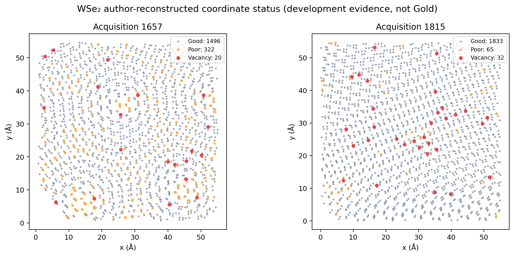
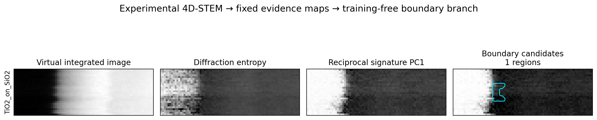

# 公开实验 STEM 数据扩展、标准化与测试（2026-07-28）

## 本轮结论

本轮不是只增加几个下载链接，而是把“公开来源发现 → 许可审计 → 文件校验 →
acquisition 分组 → 非破坏式标准化 → registry → training-free 测试”跑通了一次。

- 候选目录从 19 个来源更新为 21 个，许可不明来源继续隔离；
- 新增一份完整实验 4D-STEM acquisition：TiO₂/SiO₂，原始 HDF5 为
  142,469,777 bytes，MD5 与 Zenodo 一致；
- 新增 WSe₂ 三维原子坐标小档案，读取 12,466 条坐标，其中两份实验重建共有
  3,768 条坐标和 52 个作者 `Vacancy` 状态；
- production registry 从 v4 的 291 个资产升级为 v5 的 298 个资产，298 个文件
  SHA-256 全部复验通过；
- sample manifest v4 已识别 HDF5 的四个物理轴，并拒绝把原始 4D cube 当成普通二维图；
- 全量自动回归为 102 项通过。

这里的“标准化”不覆盖作者原文件。原始 HDF5/ZIP 原样保留，派生图、坐标清单、标签
语义、校验和和父子 lineage 分开登记。

## 本轮检索到的重点公开来源

完整的 21 个来源、许可、优先级和下一步动作见
[`public_dataset_candidate_registry_v1.yaml`](../datasets/intake/public_dataset_candidate_registry_v1.yaml)。
下面列最值得当前平台使用的实验数据。

| 来源 | 可用内容 | 许可/状态 | 本轮处理 |
|---|---|---|---|
| [Fast 4D-STEM phase mapping](https://zenodo.org/records/20366781) | TiO₂/SiO₂、NMC/LGPS 两个实验 4D cube | CC BY 4.0 | 完整纳入较小的 TiO₂ acquisition；NMC 续传受 Zenodo 504 阻断 |
| [3D defects and moiré ptychography](https://zenodo.org/records/18260255) | WSe₂ 原始 4D-STEM、重建、三维原子坐标 | CC BY 4.0 | 先纳入 169 kB 坐标档案和 README；大原始 acquisition 暂不盲目下载 |
| [4D-STEM point-defect concentration](https://zenodo.org/records/7041997) | 辐照 Al、热循环 Au 的 4D-STEM | CC BY 4.0 | 约 23.1 GB，保留为下一波 reciprocal-space 缺陷浓度数据 |
| [High-resolution SrTiO₃ 4D-STEM](https://zenodo.org/records/5113449) | 176.6 MB 原子分辨 4D-STEM | CC BY 4.0 | 适合作为 4D pipeline 正常对照，不是缺陷 Gold |
| [Graphene STEM Standard](https://zenodo.org/records/4885132) | 1.243 GB 原子分辨时序 | CC BY 4.0 | 本轮修正旧目录中“许可不明”的过时状态 |
| [Sm-BFO STEM](https://zenodo.org/records/4876786) | 2.231 GB 原子坐标、极化/畴证据 | CC BY 4.0 | 本轮修正许可状态；待极化/畴 adapter |
| [SMC graphene topological defects](https://smc-datachallenge.ornl.gov/2021-challenge-6/) | Graphene STEM movie 和逐帧缺陷坐标 | 未找到明确数据复用许可 | 保留 quarantine，不下载进正式数据树 |
| [EMSeek](https://huggingface.co/datasets/gary23ai/EMSeek) | WSe₂、FeCrAl、原子柱、颗粒等多任务数据 | Apache 2.0 | 已有 280 个资产纳管，继续作为覆盖广度主干 |
| [Guo 2021 atomic defects](https://zenodo.org/records/5520169) | MoWTe₂、Al partial dislocation、ZrO₂ twin、SuperScan | CC BY 4.0 | 已有静态图和 acquisition stack 纳管 |

检索还找到 ACS 的 MoS₂ vacancy 工作，但其 Figshare 条目实际只公开 supplementary
PDF，没有可复用的实验图像/像素标签，因此没有因为标题相关就冒充数据集纳入。

## 新数据怎样被标准化

### 1. Fast 4D-STEM

作者[公开代码](https://github.com/awwerbro/fast_mapping_4DSTEM)明确给出 HDF5
`X4D` 的轴顺序：

```text
(real-x, real-y, reciprocal-x, reciprocal-y)
```

TiO₂ acquisition 的实际 shape 为 `26 × 78 × 187 × 187`。适配器要求同时存在
`X4D`、real/reciprocal coordinates、beamstop 和 metadata；缺任意一项就拒绝猜轴。

每个 real-space 扫描点固定派生六张二维证据图：

| 派生图 | 定义 | 用途 |
|---|---|---|
| `integrated_intensity` | 对两个 reciprocal 轴求和 | 虚拟总强度图 |
| `diffraction_entropy` | 单点衍射图归一化 Shannon entropy | 漫散射/有序度差异 |
| `radial_first_moment` | 强度加权归一化倒易半径 | 散射半径变化 |
| `diffraction_peak_fraction` | 最大 detector pixel / 总强度 | spot 集中程度 |
| `signature_pc1` | 固定 4×12 极坐标分箱的 Hellinger 签名第一 SVD 坐标 | 两域/界面主输入 |
| `signature_anomaly` | 极坐标签名相对鲁棒中位数的 RMS 距离 | 开放世界异常证据 |

这一步不使用监督标签、预训练权重或网络反向传播。SVD 只对固定倒易分箱签名做每图
无监督坐标化，并用最大绝对 loading 固定符号，保证可复现。

标准化清单：
[`fast_4dstem_phase_v1.json`](../datasets/standardized/fast_4dstem_phase_v1.json)。
原始 acquisition 和六张派生图共享同一 `split_group_id`，派生图通过
`parent_asset_id` 指回 HDF5，不能跨分区。

### 2. WSe₂ 三维坐标

坐标 ZIP 不解压覆盖，而是直接在 archive 内逐成员读取，保留 CRC、字节数、实验/模拟
provenance、物种计数、Å 单位和三维边界。结果见
[`wse2_3d_coordinate_inventory_v1.json`](../datasets/standardized/wse2_3d_coordinate_inventory_v1.json)。

| acquisition | 实验坐标 | Good | Poor | Vacancy |
|---|---:|---:|---:|---:|
| 1657 | 1,838 | 1,496 | 322 | 20 |
| 1815 | 1,930 | 1,833 | 65 | 32 |
| 合计 | 3,768 | 3,329 | 387 | 52 |

新增 `wse2-3d-coordinates-v1` 标签 adapter：

- `Vacancy` → `author_reconstructed_vacancy_candidate`，Silver、`probable`；
- `Good` → 原子坐标结构参考，不等于严格的 normal/negative control；
- `Poor` → `low_confidence_atomic_coordinate`，保持 unresolved；
- 任何状态都不会自动升级成双专家实验 Gold。



## 运行测试的结果

界面分支使用 `signature_pc1`，配置固定在
[`phase_boundary_4dstem.yaml`](../configs/phase_boundary_4dstem.yaml)。没有根据结果回看
后再选择 acquisition；默认规则是在两份公开 HDF5 中按作者字节数先取较小的 TiO₂ 文件。

| 指标 | 结果 |
|---|---:|
| training / 外部权重 | 否 / 否 |
| 识别为双域 | 是 |
| 两原型分离 / 域内离散比 | 1.8029 |
| 域比例 | 0.7448 / 0.2552 |
| interface candidate | 1 个 |
| candidate bbox `(x0,y0,x1,y1)` | `(22, 8, 29, 18)` |
| candidate 像素 / 图像比例 | 56 / 2.761% |
| line skeleton | 14 pixels、2 endpoints、0 junctions |
| resolver 最终状态 | `unresolved` |



四列依次是：虚拟总强度、衍射熵、固定倒易签名 PC1、training-free 界面候选。候选落在
倒易签名由亮域到暗域的突变带附近，而不是对总强度简单做一次阈值。

这次结果能支持的表述是：

> 平台已能把公开实验 4D-STEM 标准化为可追溯的二维物理证据，并在没有训练和外部权重的
> 条件下生成与 reciprocal-signature transition 对齐的界面候选。

不能支持的表述是“界面精度达到多少”。该 archive 没有双专家像素 mask，作者 phase
context 也没有被冒充为 Gold；相界面、孪晶和取向畴在缺少 phase identity/orientation
indexing 时仍并列为 resolver 假设。

完整结果：
[`outputs/public_fast_4dstem_v3/summary.json`](../outputs/public_fast_4dstem_v3/summary.json)
（本地运行产物，默认不随 Git 发布）。

## 数据治理状态

当前权威文件：

- [`partition_registry_v5.yaml`](../datasets/partition_registry_v5.yaml)：
  298 个资产，hash
  `d26f319bbf5fc5fb2620433c4baa16a48a1a8f17e86ad8832c6c9ba89ee05fbc`；
- [`sample_manifest_v4.jsonl`](../datasets/standardized/sample_manifest_v4.jsonl)：
  298 条逐资产记录；
- [`public_dataset_operational_status_v4.json`](../datasets/intake/public_dataset_operational_status_v4.json)：
  21 个来源的当前执行状态；
- [`werbrouck_fast_4dstem_development_v1.sealed.yaml`](../datasets/intake/werbrouck_fast_4dstem_development_v1.sealed.yaml)：
  TiO₂ acquisition 的封存计划；
- [`wse2_3d_coordinates_development_v1.sealed.yaml`](../datasets/intake/wse2_3d_coordinates_development_v1.sealed.yaml)：
  WSe₂ 坐标小档案封存计划。

registry v5 分区为：

| partition | 资产数 |
|---|---:|
| `train` | 280 |
| `development_test` | 17 |
| `locked_external_test` | 1 |
| `calibration` | 0 |

`calibration=0` 仍然是投稿级证据的最大缺口；多下载无 Gold 数据不能代替它。

## 复现命令

```bash
# 可选 HDF5 依赖
python -m pip install -e ".[fourdstem]"

# 下载：已有完整文件只复验，不覆盖；失败下载从 .part 安全续传
python scripts/fetch_public_dataset.py \
  --dataset werbrouck_2026_fast_4dstem_phase \
  --manifest datasets/manifest.yaml \
  --output datasets/public

# 按固定最小文件规则标准化 TiO2
python scripts/standardize_fast_4dstem.py --acquisition tio2

# sealed intake、registry 和逐资产清单
python scripts/build_fast_4dstem_intake.py --acquisition tio2
python scripts/build_fast_4dstem_registry.py
python scripts/build_sample_manifest.py \
  --registry datasets/partition_registry_v5.yaml \
  --output datasets/standardized/sample_manifest_v4.jsonl \
  --summary datasets/standardized/sample_manifest_v4.summary.json

# training-free 界面测试
python scripts/run_fast_4dstem_smoke_test.py

# 全量回归
python -m pytest
```

所有生成器都拒绝覆盖已有 versioned manifest、registry 和结果目录。

## 下一步最值得做什么

1. Zenodo 恢复后续传 NMC/LGPS，MD5 完整后单独建立 `standardized_v2`，不回写 v1；
2. 从 WSe₂ 1657/1815 中按预注册规则选择一份原始 4D-STEM，与 52 个作者 vacancy
   状态建立坐标—图像配准测试；
3. 对 4D-STEM 新增 reciprocal-signature 专用 interface teacher，显式输出整条 line
   candidate 与边缘可靠性，而不是只依赖二维 phase-boundary 分支的小图 border margin；
4. 寻找/制作 acquisition-aware 双专家 Gold calibration；在此之前，新增数据用于
   development、OOD 和证据覆盖，不能用于夸大独立泛化精度。

## 失败与保留产物

- NMC/LGPS 下载在 14,259,512 bytes 后遭遇 Zenodo 504；`.part` 被原样保留，没有纳入
  sealed plan、registry 或测试；
- 第一次 smoke 汇总使用了错误字段名 `task_name`，检测 artifacts 已生成但汇总中断；
  `outputs/public_fast_4dstem_v1/` 被保留作失败运行审计，未删除；
- 修复后 v2、v3 均成功，本文使用排版更紧凑的 v3 gallery；
- 本轮没有删除任何数据集、原始文件、失败分片或既有结果。
