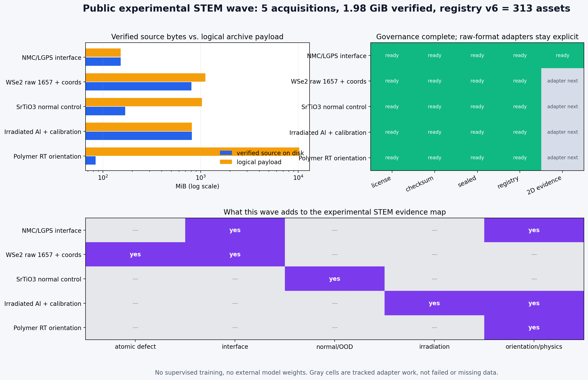
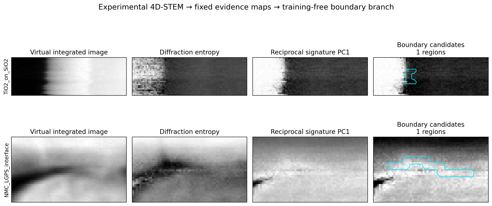

# 公开实验 STEM 数据第二波：下载、封存、标准化与测试（2026-07-29）

## 一句话结论

这次把上一轮“已找到但未落盘”的高价值实验数据继续推进到了可审计状态：

- 新验证 5 个 acquisition/样本组、2,124,675,679 bytes（1.98 GiB）；
- NMC/LGPS、WSe₂ 1657、SrTiO₃、辐照 Al、聚合物室温 4D-STEM 均已落盘；
- 第二波 8 个源文件和 NMC 的 7 个原始/派生资产进入 registry v6；
- registry 从 298 增加到 313 个资产，313 个 SHA-256 全部复验通过；
- sample manifest v5 有 313 条记录，不再把任意 HDF5 错当成同一种 4D schema；
- NMC/LGPS 已生成六种二维物理证据并完成 training-free 界面 smoke test；
- 公开来源目录从 21 增加到 23 个，较大但有价值的来源保留完整元数据而不盲目下载。
- 全量自动回归 103 项通过。

这里的“搜集完整”指：来源、许可、固定版本、文件、校验和、acquisition 分组、准入状态和
下一适配动作完整可追溯；不等于把 23 个来源中超过 180 GB 的全部字节无差别复制到本地。



## 已完成下载和校验

| 数据 | 本轮文件 | bytes | MD5 | 当前用途 |
|---|---|---:|---|---|
| [Fast 4D-STEM](https://zenodo.org/records/20366781) | `NMC_LGPS_dataset.h5` | 159,258,737 | `c3d63c…139d0` | NMC/LGPS 相界面、倒易签名 |
| [WSe₂ 3D defects](https://zenodo.org/records/18260255) | `1657.zip` + 坐标 + README | 846,093,387 | 逐文件已验 | 原子缺陷、moire、重建—坐标配对 |
| [SrTiO₃ high-resolution 4D-STEM](https://zenodo.org/records/5113449) | MIB ZIP + notebook | 177,133,475 | 逐文件已验 | 原子分辨正常/OOD 对照 |
| [4D-STEM point-defect concentration](https://zenodo.org/records/7041997) | 辐照 Al DM4 + calibration H5 | 853,830,107 | 逐文件已验 | 辐照损伤、缺陷浓度、应变 |
| [Polymer in-situ 4D-STEM](https://zenodo.org/records/18572179) | 最小室温 ZIP | 88,359,973 | `3c969c…0736` | 取向、相演化、跨域物理 |

选择规则在检测前固定：

- WSe₂ 在三份实验 acquisition 中按公开 bytes 选择最小的 `1657.zip`；
- 聚合物在八份温度 acquisition 中按公开 bytes 选择最小的室温文件；
- 23.1 GB 的缺陷浓度记录先取科学上成对的“辐照 Al + 对应 calibration”，不拆散；
- SrTiO₃ 记录只有一份 acquisition，因此 archive 和作者 notebook 一起保留。

下载器只写 `.part`，大小和 MD5 同时一致后才改为最终文件名；已有完整文件只复验，不覆盖。
本轮 Zenodo 曾对辐照 Al 返回一次 504，重试前 `.part` 没有被伪装成完整数据。

## 容器内部实际是什么

统一清单见
[`public_dataset_wave_v1.json`](../datasets/standardized/public_dataset_wave_v1.json)。
清单只读取 ZIP 目录、HDF5 数据树或 DM4 头部，不批量解压源数据。

| 来源 | 容器内部 | 处理决定 |
|---|---|---|
| WSe₂ 1657 | `scan_x128_y128.raw` 1.091 GB + `Niter64.mat` 85.3 MB | 可做流式 EMPAD 与 ptychography adapter |
| SrTiO₃ | 64 个约 16.9 MB 的 MIB 分片 + HDR，逻辑总量 1.080 GB | 需要 MIB virtual-detector adapter |
| 辐照 Al | 839.5 MB DM4 + 14.4 MB、40 datasets 的 py4DSTEM calibration H5 | H5 已安全列树；DM4 尚需解析器 |
| 聚合物 RT | ZIP 仅 88.4 MB，但内部单个 DM4 为 10.750 GB | 压缩比 121.66，明确禁止批量解压 |

聚合物文件不是损坏，也不是可以随手解压的小文件。平台将
`logical/archive ratio >= 50` 标为 `do_not_bulk_extract`，后续只能在磁盘检查后流式读取。

## NMC/LGPS 的标准化和实测

两份 Werbrouck HDF5 已共同进入
[`fast_4dstem_phase_v2.json`](../datasets/standardized/fast_4dstem_phase_v2.json)。
每份 acquisition 固定派生：

1. virtual integrated intensity；
2. diffraction entropy；
3. radial first moment；
4. diffraction peak fraction；
5. fixed polar-signature PC1；
6. signature anomaly。

整个过程不使用监督训练、反向传播或外部权重。v4 图中每一行对应一份独立 acquisition，
四列依次为总强度、衍射熵、倒易签名 PC1、界面候选：



| acquisition | genuine two-domain | 原型分离/域内离散 | candidate fraction | regions |
|---|---:|---:|---:|---:|
| TiO₂/SiO₂ | 是 | 1.8029 | 2.761% | 1 |
| NMC/LGPS | 是 | 2.3136 | 9.788% | 1 |

NMC/LGPS 候选沿着横向弯曲过渡带延展，说明第二份材料并非简单复现 TiO₂ 的竖直边界。
但两份 archive 都没有双专家像素 Gold，因此这里是“物理证据与定性定位 smoke test”，
不能把 candidate fraction 或原型分离比改写成准确率。

完整运行摘要：
[`outputs/public_fast_4dstem_v4/summary.json`](../outputs/public_fast_4dstem_v4/summary.json)
（运行目录默认不随 Git 发布）。

## 数据治理现状

当前权威入口：

- [`partition_registry_v6.yaml`](../datasets/partition_registry_v6.yaml)：
  313 个资产，hash
  `48befa710cc2a2fadd5c845ff7ceee6b422ba5274152809854bf5a1f41010b0c`；
- [`sample_manifest_v7.jsonl`](../datasets/standardized/sample_manifest_v7.jsonl)：
  313 条逐资产格式、角色、统一访问契约和运行条件；
- [`public_dataset_operational_status_v6.json`](../datasets/intake/public_dataset_operational_status_v6.json)：
  23 个公开来源的真实执行状态；
- [`public_dataset_candidate_registry_v1.yaml`](../datasets/intake/public_dataset_candidate_registry_v1.yaml)：
  许可、规模、任务覆盖和下一步动作。

registry v6 分区：

| partition | assets |
|---|---:|
| `train` | 280 |
| `development_test` | 32 |
| `locked_external_test` | 1 |
| `calibration` | 0 |

新增原始 4D 数据全部在 `development_test`，`eligible_for_active_learning=false`。它们不能因
下载成功就回流到训练或阈值选择，更不能升级成 Gold。

四个新 intake plan 均已封存：

- WSe₂ `1657` raw + coordinates；
- SrTiO₃ MIB archive + notebook；
- 辐照 Al DM4 + calibration；
- 聚合物室温 archive。

NMC/LGPS 与 TiO₂ 也已在两 acquisition 的新 sealed plan 中共同验证。旧的单 TiO₂ plan
保留作历史审计，没有覆盖。

## 新检索到但没有盲目下载的来源

公开目录新增：

- [MoS₂–MoSe₂ lateral heterojunction 4D-STEM](https://zenodo.org/records/17246822)：
  实验原始文件 4.362 GB，适合异质界面和应变；已记录许可、MD5、文件规模和任务，但待
  当前 compact wave 的 raw adapter 稳定后再下载；
- [Warwick-STEM WebDataset mirror](https://huggingface.co/datasets/Stemson-AI/Warwick-STEM)：
  19,769 张实验 STEM、170 个约 1 GB shard，适合自监督/OOD，不是缺陷像素 Gold；
- 聚合物八温度 in-situ 4D-STEM 已完整登记，但只下载预先固定的最小室温 acquisition。

许可不明的 TEM ImageNet、Ayyubi、WS₂ tracking 和 SMC graphene 继续 quarantine，没有
下载进正式数据树。

## 现在“完整”和“不完整”的边界

已完整：

- 本轮五个 acquisition 的源文件、校验和、许可、分组、sealed plan；
- 23 来源机器可读目录；
- registry、sample manifest、容器清单、状态可视化；
- TiO₂/NMC 的 HDF5 → 二维证据 → training-free 界面测试。

仍需代码适配、不是下载失败：

- WSe₂ `Niter64.mat` 重建与 1657 作者坐标的方向/原点配准；
- SrTiO₃ MIB 的流式 virtual detector；
- 辐照 Al DM4 的 4D scan 解码并与 calibration 绑定；
- 聚合物 10.75 GB 逻辑 DM4 的流式 orientation map；
- MoS₂–MoSe₂ 4.36 GB 异质界面 acquisition 的下一波下载。

仍需人、不能由继续下载替代：

- 双专家 acquisition-aware Gold calibration；
- 新的、从未用于开发的 locked external test；
- 显微镜条件和物理语义复核。

## 复现命令

```bash
# 只复验或安全续传；不会覆盖完整文件
python scripts/fetch_public_dataset.py \
  --dataset mills_2022_irradiated_al_4dstem \
  --manifest datasets/manifest.yaml --output datasets/public

# NMC + TiO2 非破坏标准化和 training-free 测试
python scripts/standardize_fast_4dstem.py \
  --acquisition all \
  --output-root datasets/public/werbrouck_2026_fast_4dstem_phase/standardized_v2 \
  --manifest datasets/standardized/fast_4dstem_phase_v2.json
python scripts/run_fast_4dstem_smoke_test.py \
  --manifest datasets/standardized/fast_4dstem_phase_v2.json \
  --output outputs/public_fast_4dstem_v4 \
  --gallery-copy docs/assets/fast_4dstem_test_gallery_v4.png

# 新来源封存、容器清单、registry 和逐资产 manifest
python scripts/build_public_dataset_wave_intakes.py
python scripts/inventory_public_dataset_wave.py
python scripts/build_public_dataset_wave_registry.py
python scripts/build_sample_manifest.py \
  --registry datasets/partition_registry_v6.yaml \
  --output datasets/standardized/sample_manifest_v8.jsonl \
  --summary datasets/standardized/sample_manifest_v8.summary.json
```

所有 versioned 生成器都会拒绝覆盖已有 plan、manifest、registry、图和运行目录。

## 失败与保留项

- 聚合物第一次请求因文件名中的步长误写为 `15nm` 返回 404；按 Zenodo 原记录纠正为
  `10nm` 后通过 MD5。没有形成或删除错误数据文件；
- 辐照 Al 第一次请求返回 504；随后用同一 DOI 的 Range 探测确认官方入口恢复，再安全
  下载并校验；
- sample manifest 第一次生成发现 calibration H5 被旧代码错误套用 Werbrouck schema，
  生成在写盘前中止；修复为 generic HDF5 inventory 后成功；
- 第一次双 acquisition intake 输出沿用了旧 `plan_id=v1`；该中间 plan 按审计规则保留，
  权威文件是内部 ID 已升级为 v2 的
  `werbrouck_fast_4dstem_development_v3.sealed.yaml`；
- 本轮没有删除数据集、分片、旧 plan 或旧结果。
