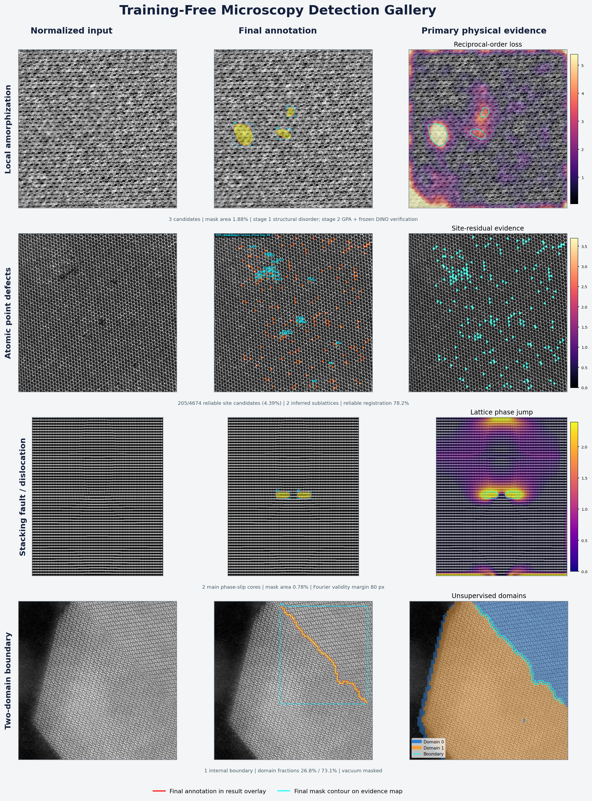
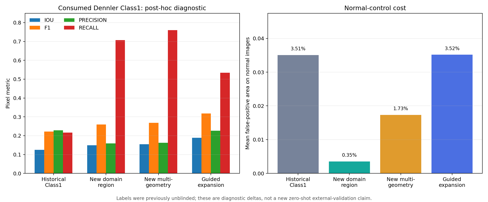
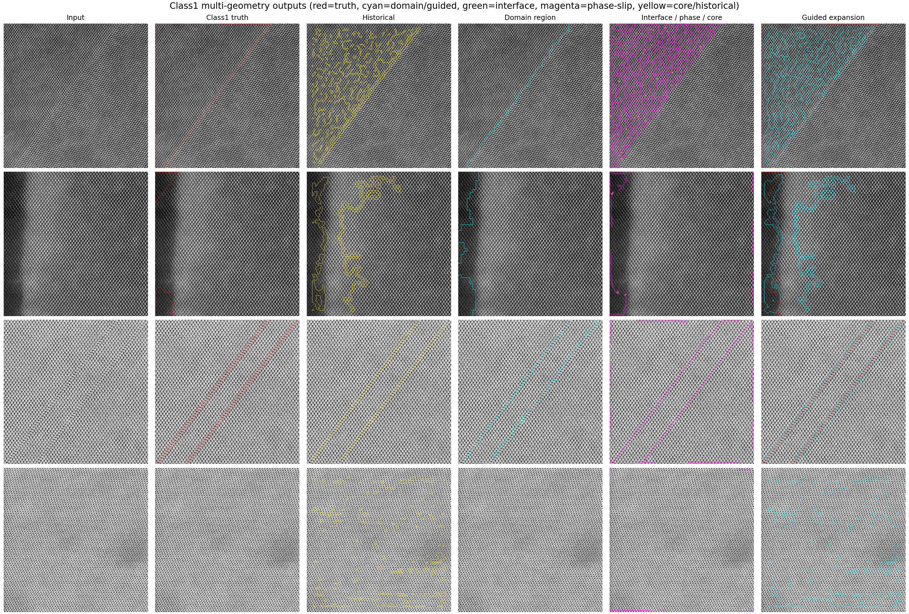
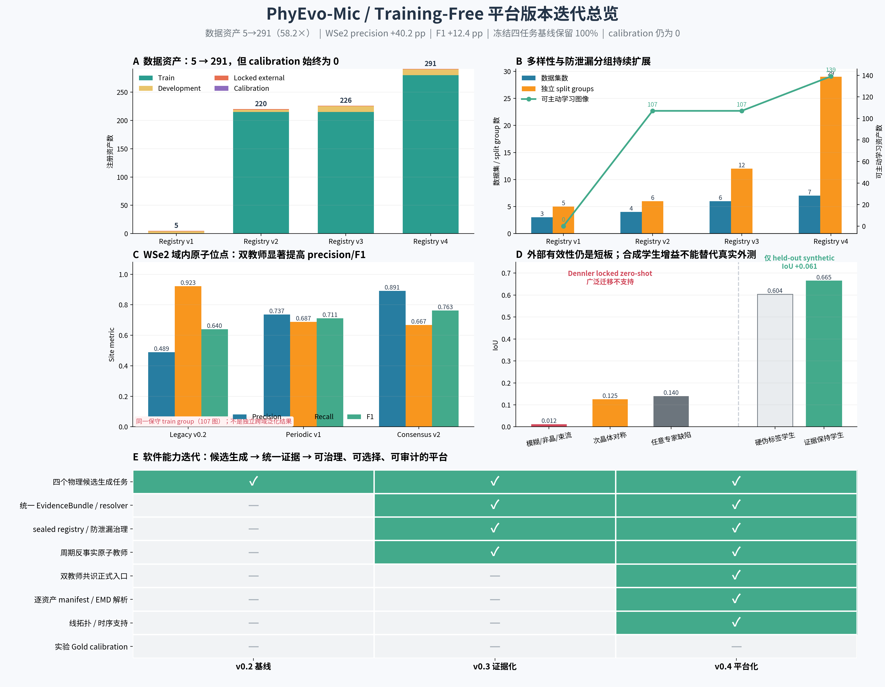

# 当前效果总览

## 五任务示例



当前平台覆盖局部非晶、原子点异常、层错/相位滑移、两相/孪晶界面以及新的群关系
Class1。可视化保留原子像底图，并使用轮廓或几何对象表达候选，而不是用统一 box 覆盖
所有缺陷。

更详细的逐任务面板见 [可视化说明](visual_gallery_zh.md)。

## Class1 最新结果



Dennler Class1 已消费数据上的事后诊断：

| 方法 | IoU | F1 | Recall | 正常图平均误报 |
|---|---:|---:|---:|---:|
| 历史 Class1 | 0.1251 | 0.2224 | 0.2162 | 3.5067% |
| 新 symmetry domain | 0.1489 | 0.2593 | 0.7071 | 0.3546% |
| 新多几何 | 0.1549 | 0.2682 | 0.7608 | 1.7303% |
| 保守引导扩展 | **0.1891** | **0.3181** | **0.5338** | **3.5150%** |



颜色语义：

- 青色：symmetry domain 或 guided region；
- 绿色：interface；
- 品红：phase-slip line；
- 黄色：历史候选或 dislocation-core proxy；
- 红色：只在事后评分图中出现的 Dennler 标签。

完整方法与限制见 [Class1 群关系报告](class1_symmetry_relation_final_zh.md)。

## 版本收益



平台从单一局部非晶原型发展为：

```text
多任务 physics teachers
  → EvidenceBundle / resolver / reliability
  → 多来源数据治理
  → 反事实与双教师共识
  → active review / calibration / release gate
  → Class1 群关系与多几何
```

## 应怎样理解这些结果

已经支持的结论：

- 五任务共享统一入口、配置、证据协议和可审计输出；
- 合成回归、正常对照和已消费真实数据均能批量运行；
- Class2 coherence-loss 与 Class1 欠覆盖原因均已定位并出现明显事后改善；
- 97 项自动测试通过。

尚不支持的结论：

- 不能把 Dennler 事后增益称为新的零样本外测；
- 没有独立 Gold calibration，confidence/reliability 不是经验概率；
- 位错芯仍是 proxy，尚未由 Burgers circuit 证明；
- 主动学习和学生模型的软件闭环已存在，但跨实验室持续增益尚未被证明；
- 尚未达到 Nature Methods 级别的前瞻性、多中心、独立验证证据。

