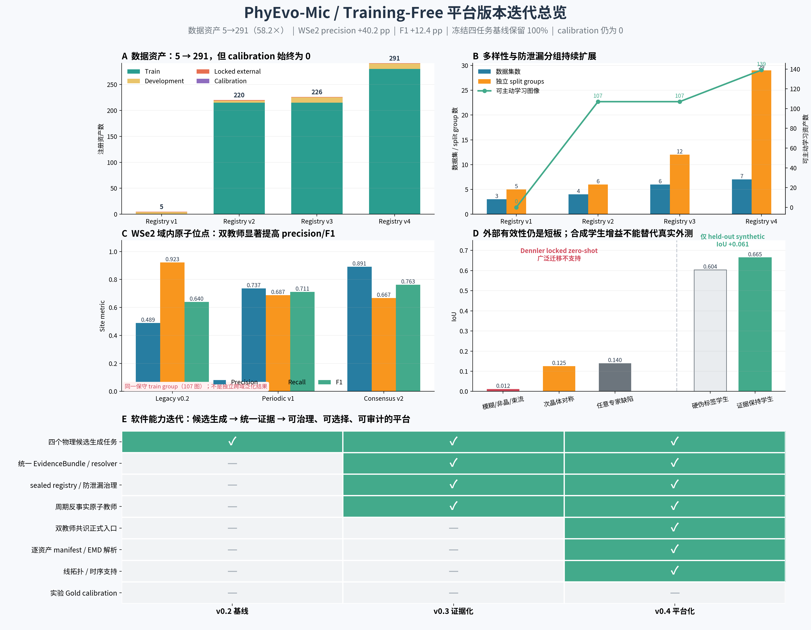

# 数据资产与版本迭代效果对比

> 审计日期：2026-07-28  
> 推荐汇报图：`outputs/version_iteration_comparison_v3/`  
> 可机读数据：[`version_comparison_data.json`](../outputs/version_iteration_comparison_v3/version_comparison_data.json)

## 一句话结论

当前版本相对初始版本的确定性提升主要有三类：

1. **数据资产从 5 个增加到 291 个，来源从 3 个数据集增加到 7 个，防泄漏
   split group 从 5 个增加到 29 个**；
2. **WSe2 同一训练域的原子位点检测从高召回、低精度，变为更少但更可信的候选**：
   precision 从 0.4895 提高到 0.8914，F1 从 0.6396 提高到 0.7633，
   但 recall 从 0.9226 降到 0.6674；
3. 平台从四个独立的 Training-Free 候选生成器，扩展为带逐资产 provenance、
   EvidenceBundle、resolver、防泄漏 registry、双教师共识、线拓扑和时序支持的
   可审计框架。

同时，**真实跨域泛化并没有随资产数量自动变好**。Dennler 锁定外测的任意专家缺陷
IoU 只有 0.1396，且四版 registry 的实验 Gold calibration 资产数始终为 0。
所以当前最准确的表述是“数据覆盖、域内选择性和软件能力明显提升”，不能表述为
“真实世界精度已经提高 58.2 倍”或“已经完成 Nature 级方法学验证”。

## 两套版本号不要混用

项目中存在两类版本：

- **Registry v1–v4**：描述注册了哪些数据、放在哪个 partition、如何避免同源泄漏；
- **平台阶段 v0.2–v0.4**：描述算法和软件能力，分别对应基线、证据化、平台化。

Registry 数字增长不能直接当作算法精度增长；平台新增能力也必须在同一评测集上比较，
才能归因于方法迭代。

## 数据资产四版区别

| Registry | 资产数 | Train / Dev / Locked / Calibration | 数据集 | Split groups | 可主动学习资产 | 本版主要变化 |
|---|---:|---:|---:|---:|---:|---|
| v1 | 5 | 0 / 4 / 1 / 0 | 3 | 5 | 0 | 本地分子筛、Guo 静态样例和 Dennler 锁定入口；仅能做最小烟雾测试 |
| v2 | 220 | 215 / 4 / 1 / 0 | 4 | 6 | 107 | 纳入 215 个 EMSeek WSe2 资产，其中 107 个进入保守 train group 的主动学习/开发评测 |
| v3 | 226 | 215 / 10 / 1 / 0 | 6 | 12 | 107 | 增加 1 个 SuperScan 资产和 5 个 Al Σ3 孪晶边界资产，补充序列与界面场景 |
| v4 | 291 | 280 / 10 / 1 / 0 | 7 | 29 | 139 | 增加 65 个 EMSeek 多场景均衡子集，扩展到 16 类场景，增强开放世界覆盖 |

从 v1 到 v4：

- 注册资产为 **58.2 倍**；
- 数据集为 **2.33 倍**；
- split groups 为 **5.8 倍**；
- 可主动学习资产从 0 增至 139；
- calibration 资产仍为 **0**。

这里的“资产”是 registry 中可校验、可追踪、带 partition 的输入单位，不等于 291 个
独立材料体系，也不等于 291 个 Gold 标注样本。尤其 EMSeek 资产仍集中在公开来源，
不能替代跨实验室采集。

## 平台三阶段区别

| 阶段 | 已具备的能力 | 当时能回答的问题 | 仍不能回答的问题 |
|---|---|---|---|
| v0.2 基线 | 非晶、原子点缺陷、层错线、相界面四个物理候选生成器；冻结合成数值基线 | 四个 Training-Free detector 是否可运行、是否发生回归 | 候选为何成立、证据是否可靠、同源数据是否泄漏、教师冲突如何保留 |
| v0.3 证据化 | EvidenceBundle、resolver、候选状态、sealed registry、周期反事实原子教师 | 多个证据如何组合；artifact、unresolved 和 probable 如何区分 | 双教师共识正式入口、逐资产 manifest、线拓扑和时序证据 |
| v0.4 平台化 | 双教师共识、逐资产 manifest/EMD 解析、线拓扑、时序支持、开放世界资产治理 | 如何得到可追踪、可复查、可供主动学习的候选 | 独立 Gold calibration、全新 locked test、跨材料/跨实验室效益、在线闭环 |

v0.3 和 v0.4 是**功能阶段**，不是每一项都已有独立准确率结果的软件发行版。
其中 v4 相对 v3 的新增价值主要是数据场景和平台能力扩展；目前没有一组新的实验 Gold
能够把 v3→v4 解释为真实精度增益。

## 同口径测试效果

### 1. 冻结四任务合成基线：平台扩展没有破坏旧能力

[`baseline_v0_2_manifest.json`](../benchmarks/baseline_v0_2_manifest.json)
中的确定性合成基线为：

| 任务 | IoU | Precision | Recall |
|---|---:|---:|---:|
| 非晶区域 | 0.8609 | 0.8833 | 0.9715 |
| 原子点缺陷 | 0.6739 | 1.0000 | 0.6739 |
| 层错线 | 0.5910 | 0.7975 | 0.6953 |
| 相界面 | 0.4742 | 0.7955 | 0.5401 |
| 四任务平均 IoU | **0.6500** | — | — |

当前回归结果与 v0.2 冻结值重合，旧任务数值保留率为 100%。这证明“加平台能力没有
弄坏冻结基线”，但合成数据只适合做回归门禁，不能证明真实 STEM 泛化。

### 2. WSe2 原子位点：域内候选变得更保守

以下三个结果都来自同一保守 train group 的 107 张图和 16,030 个作者位点，
不是独立跨域外测：

| 方法 | Precision | Recall | F1 | 预测位点 | 匹配位点 | 平均定位误差 / px |
|---|---:|---:|---:|---:|---:|---:|
| Legacy v0.2 | 0.4895 | 0.9226 | 0.6396 | 30,213 | 14,789 | 0.6906 |
| Periodic v1 | 0.7367 | 0.6874 | 0.7112 | 14,958 | 11,019 | 1.1501 |
| Consensus v2 | **0.8914** | 0.6674 | **0.7633** | 12,001 | 10,698 | 0.8348 |

Consensus v2 相对 Legacy v0.2：

- precision **+40.2 个百分点**；
- F1 **+12.4 个百分点**；
- recall **−25.5 个百分点**；
- 输出候选数从 30,213 降至 12,001，减少约 **60.3%**。

因此它的收益不是“所有指标全面抬升”，而是用双教师一致性筛掉大量可疑候选，使人工
复核负担更小、候选纯度更高；代价是漏掉更多真位点。单教师分歧没有被删除，而是以
unresolved 保存，后续应交给主动学习或专家复核。

### 3. Dennler 锁定外测：跨域仍然失败

61 张图的已消费 locked zero-shot 结果为：

| 目标 | IoU | Precision | Recall |
|---|---:|---:|---:|
| 模糊/非晶/束流复合 | 0.0118 | 0.9319 | 0.0118 |
| 次晶体对称复合 | 0.1251 | 0.2291 | 0.2162 |
| 任意专家标注缺陷 | **0.1396** | 0.4522 | 0.1680 |

第一项 precision 高而 recall 极低，表示模型只报了极少数区域；这不是好用的检测器。
该结果应作为负结果保留：当前四类物理先验、本体映射和阈值没有覆盖 Dennler 中足够多的
专家缺陷定义，广泛迁移主张不成立。

### 4. 学生模型消融：只在合成扰动上有正增益

在 held-out synthetic 旋转/噪声条件上，证据保持学生 IoU 为 0.6648，硬伪标签学生
IoU 为 0.6037，差值为 **+0.0612**。这说明保留软证据和不确定性比硬伪标签更有潜力；
但该结果既不是跨材料结果，也不是外部真实数据验证，当前 release claim 被明确禁止。

## 可视化怎么读

### 总览图



- **A**：四版 registry 的 Train、Development、Locked 和 Calibration 资产组成；
- **B**：数据来源、split group 和可进入主动学习的资产增长；
- **C**：WSe2 同域原子位点三代教师的 precision、recall、F1；
- **D**：左侧是真实 Dennler 外测，右侧是合成学生消融，两者被虚线分开，不能互相替代；
- **E**：v0.2→v0.4 的软件能力矩阵，最后一行说明实验 Gold calibration 尚缺。

### 效果细图


- **A**：原子教师在 precision–recall 平面上的移动，清楚显示“向高精度、低召回移动”；
- **B**：Consensus v2 相对 Legacy v0.2 的百分点变化；
- **C**：柱子是冻结 v0.2 合成 IoU，空心圆是当前回归结果；二者重合表示无回归。

## 当前该如何向老师汇报

建议使用下面这组表述：

> 我们已经把初始四任务 Training-Free 原型扩展成可审计的平台。注册资产从 5 增至
> 291，覆盖 7 个数据集和 29 个独立分组；WSe2 同域双教师共识将原子候选 precision
> 从 0.489 提高到 0.891、F1 从 0.640 提高到 0.763，但以 recall 降低为代价。
> 冻结四任务基线无回归。Dennler 锁定外测 IoU 只有 0.140，说明跨域泛化仍未解决；
> 下一步必须补独立 Gold calibration、扩充缺陷本体，并使用全新跨实验室 locked test。

## 可复现入口

重新生成比较数据和图：

```bash
python scripts/build_version_iteration_comparison.py \
  --output outputs/version_iteration_comparison_v4
```

输出目录必须是新目录，脚本不会覆盖既有审计产物。权威输入包括：

- [`partition_registry.yaml`](../datasets/partition_registry.yaml) 至
  [`partition_registry_v4.yaml`](../datasets/partition_registry_v4.yaml)；
- [`baseline_v0_2_manifest.json`](../benchmarks/baseline_v0_2_manifest.json)；
- WSe2 三组 development metrics：
  [`Legacy`](../benchmarks/development_runs/emseek_wse2_legacy_atomic_v0_2_score_v2/development_metrics.json)、
  [`Periodic`](../benchmarks/development_runs/emseek_wse2_periodic_v1_score_v2/development_metrics.json)、
  [`Consensus`](../benchmarks/development_runs/emseek_wse2_two_teacher_consensus_v2_score/development_metrics.json)；
- [`Dennler locked metrics`](../benchmarks/locked_runs/dennler_v1_score/locked_metrics.json)；
- [`学生模型消融`](../benchmarks/latest_student_ablation.json)。
