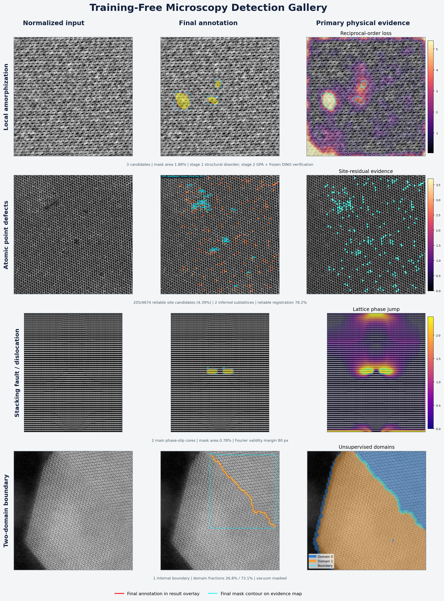

# Training-Free 多任务可视化图集说明

这套图集把四类缺陷放到同一套版式中比较：

1. 局部非晶；
2. 原子点缺陷；
3. 层错/部分位错；
4. 两相或孪晶界面。

最终总览见[任务总览图](assets/multitask_overview.png)。四张可放大查看的
单任务图位于：

- [局部非晶详图](../outputs/visual_gallery_v2/amorphous_example.png)
- [原子点缺陷详图](../outputs/visual_gallery_v2/atomic_point_defect_example.png)
- [层错/位错详图](../outputs/visual_gallery_v2/stacking_fault_example.png)
- [两域界面详图](../outputs/visual_gallery_v2/phase_boundary_example.png)



## 先说明：为什么证据图仍然能看到原子相

Fourier 失序分数、GPA 应变、晶格相位跳变和域归属都是二维标量场，不是另一张显微照片，
也不是算法“复原”出来的原子像。若把它们单独用伪彩色显示，原子点阵自然会消失，看起来会
和原图很不一样。

这套图集采用统一的叠加方法：

- 底层始终是同一幅百分位归一化后的灰度显微图；
- 上层才是半透明标量热图；
- 青色轮廓表示最终二值候选掩膜；
- `Final annotation` 面板沿用正式结果中的红色填充/轮廓和青色框、区域编号；
- 色条表示当前证据的相对数值，不是经过标签校准的缺陷概率。

因此既能看到算法依据的连续证据，也能同时检查证据是否落在合理的原子结构位置。不同面板
间灰度原子像没有被替换，只是覆盖了透明度随证据强度变化的颜色。

## 总览图怎样读

总览图每一行是一类任务，每一列含义一致：

| 列 | 内容 | 用途 |
|---|---|---|
| `Normalized input` | 定量安全归一化后的原始显微图 | 检查真实结构、真空、边缘和扫描背景 |
| `Final annotation` | 通过阈值、有效区、形态学和连通域质控后的最终结果 | 查看框架真正报告的候选 |
| `Primary physical evidence` | 该任务最关键的一个物理证据，半透明叠加在原图上 | 解释候选为什么出现在该位置 |

总览右列的主证据依次是：

- 非晶：局部倒易有序度下降；
- 点缺陷：预期晶格位点与观测原子柱之间的残差；
- 层错：两条倒易载波解调得到的晶格相位突变；
- 两域界面：局部 Fourier 签名无监督分成的两个域。

## 示例 1：局部非晶

[详图](../outputs/visual_gallery_v2/amorphous_example.png)中的六个面板为：

| 面板 | 标注 | 含义 |
|---|---|---|
| A | `Normalized microscopy input` | 原始拉伸测试后分子筛图像 |
| B | `Final candidate annotation` | 第一阶段最终得到的 3 个局部非晶候选 |
| C | `Fused continuous score` | 频谱、Patterson 和清晰度证据融合前后的连续异常强度 |
| D | `Reciprocal-order loss` | 局部倒易峰变宽、平坦化或峰集中度下降 |
| E | `GPA lattice coherence` | 主晶格复数载波的局部相干程度 |
| F | `GPA strain magnitude` | 相干度足够位置相对于全图主晶格的二维投影应变幅值 |

当前结果为 3 个候选，总面积 39,411 px，占图像 1.88%。B 中黄色半透明区域和红色边缘是
最终候选；D–F 中的青色线是同一掩膜，不是额外检测结果。

解释时需要分两层：

1. 第一阶段用结构失序证据提出“局部非晶候选”；
2. 第二阶段不在完全失序核心里强行找原子，而是在核心的可靠像素及 12–90 px 周围过渡带
   分析晶格相干度、拉伸/压缩和剪切，并以冻结 DINO 提供独立纹理偏离验证。

GPA 应变是相对于图中主晶格的二维投影量。扫描畸变、厚度、样品倾斜和局部失焦仍可能贡献
信号，所以这些区域是结构异常候选，不是无需复核的材料学真值。完整定量数据见
[`stage2_summary.json`](../outputs/reference_amorphous_stage2_final/stage2_summary.json)。

## 示例 2：原子点缺陷

[详图](../outputs/visual_gallery_v2/atomic_point_defect_example.png)使用公开 MoWTe₂ 原子分辨图像：

| 面板 | 标注 | 含义 |
|---|---|---|
| A | 输入图 | 原子柱强度和局部晶格形变 |
| B | 最终标注 | 所有 205 个候选均以红色标出；为避免遮挡，只给分数最高的 30 个画框和编号 |
| C | 融合分数 | 逐位点存在性、强度和位移残差的连续分数 |
| D | `Presence / intensity residual` | 预期位置缺峰、低强度或异常强度证据 |
| E | `Displacement residual` | 去除非刚性漂移后，原子柱偏离局部晶格位置的程度 |
| F | `Registration reliability` | 哪些区域具有足够匹配位点，可相信晶格配准 |

框架从图像中自动推断 2 个子晶格和 4,674 个预期位点，在可靠配准区域保留 205 个候选，
占预期位点的 4.39%。候选类型按当前结构证据分为：

- 137 个 `vacancy_or_low_intensity_column`；
- 56 个 `intensity_or_substitution_anomaly`；
- 12 个 `displaced_atom_column`。

这些名字描述的是图像证据，不等同于已经确定化学元素。例如单幅 HAADF 中的低强度柱还可能
受厚度、倾斜、表面或扫描条件影响。材料、晶胞或元素先验已知时，应提供真实结构骨架而不是
只依赖自动子晶格推断。完整候选列表见
[`summary.json`](../outputs/public_mowte2_atomic_defects_final_v2/summary.json)。

### 原子点缺陷开发扩展：双物理教师

MoWTe₂ 图例展示 v0.2 位点配准教师的内部证据；新的 EMSeek WSe₂ 开发域结果进一步加入
周期反事实教师和双教师共识：

- [互补教师 precision/recall/F1 与 107 张图逐图分布](../benchmarks/development_runs/emseek_wse2_two_teacher_consensus_v2_score/teacher_consensus_summary_final.png)
- [图像 23：原图、作者点标注、教师一致/不一致和 TP/FP/FN](../benchmarks/development_runs/emseek_wse2_two_teacher_consensus_v2_score/teacher_consensus_overlay_image23_final.png)

叠加图中的绿色大圆是两种物理教师一致的 Silver 点；橙色是 periodic-only，蓝色小圆是
legacy-only，它们都保留为 Unresolved。最后一列的 TP/FP/FN 只用于同一 train group 内的
开发诊断。圆表示点中心，不表示真实原子半径或分割轮廓。

共识层 site precision 0.8914、recall 0.6674、F1 0.7633，但仍有三个零共识图像。由于
107 张图属于一个保守 train group，这两张图不能当作独立材料或外部实验室测试。方法和
完整边界见
[`periodic_counterfactual_and_consensus_zh.md`](periodic_counterfactual_and_consensus_zh.md)。

## 示例 3：层错与部分位错

[详图](../outputs/visual_gallery_v2/stacking_fault_example.png)使用模拟 Al 部分位错图像：

| 面板 | 标注 | 含义 |
|---|---|---|
| A | 输入图 | 规则原子列及中心结构扰动 |
| B | 最终标注 | 两个主要相位滑移/部分位错核心 |
| C | 融合分数 | 四类相位证据的连续响应，尚未等同于最终掩膜 |
| D | `Lattice phase jump` | 复解调相位沿空间发生突变的位置 |
| E | `Shear / rotation evidence` | 位移梯度中的剪切和局部旋转 |
| F | `Coherence-loss evidence` | 晶格载波在缺陷附近失去相干性的程度 |

最终报告 2 个主要核心，总面积占 0.78%。外围 80 px 因 Fourier 支持不完整而不参与最终
候选判定。

C、D、F 中仍能看到边缘和较长的条带响应。这些是连续中间证据，并不都是最终缺陷；框架还会
应用有效区、最小相干度、多证据一致性、阈值、形态学和连通域质控。因此判断结果应看 B 或
青色最终轮廓，不能把热图上所有亮点都当成层错。

该任务检测的是“与层错/位错兼容的相位滑移证据”。扫描跳变、强弯曲和厚度突变可能产生相似
响应，需结合采集元数据或结构模型复核。完整结果见
[`summary.json`](../outputs/public_al_stacking_fault_final_v2/summary.json)。

## 示例 4：两相/孪晶界面

[详图](../outputs/visual_gallery_v2/phase_boundary_example.png)使用 ZrO₂ 孪晶界面图像：

| 面板 | 标注 | 含义 |
|---|---|---|
| A | 输入图 | 晶体颗粒和左侧低对比真空 |
| B | 最终标注 | 一条内部两域界面，红色为界面带，青框为连通域范围 |
| C | 融合分数 | 界面候选的连续响应 |
| D | `Unsupervised domain assignment` | 局部极坐标 Fourier 签名分成的域 0 和域 1 |
| E | `Domain membership margin` | 局部窗口更接近其中一个域原型的可信间隔 |
| F | `Crystalline support` | 用于排除真空和低晶体对比区域的有效样品掩膜 |

当前得到 1 条内部界面，两个域的有效面积约为 26.8% 和 73.1%。蓝色/橙色只是一次运行中
无监督原型的编号，顺序可互换，不代表已识别的化学相名称。左侧真空没有被当成第三相；它先由
局部晶体对比度屏蔽，再进行两域建模。完整结果见
[`summary.json`](../outputs/public_zro2_phase_boundary_final_v2/summary.json)。

## SAM、DINO 在这套展示中的位置

- DINO 只用于局部非晶的第二阶段独立验证，而且权重冻结，不参与阈值训练或像素分类。
- 点缺陷、层错和两域界面的当前主判据均是晶格/频域物理证据，没有用 DINO 替代结构分析。
- 当前图集没有用 SAM 改写最终掩膜。SAM 更适合在已经有物理候选、且对象边缘在图像中可分
  的情况下细化轮廓；原子失序和相位滑移未必具有自然图像式对象边缘。

## 数据来源与评估边界

后三个案例来自 Guo 等人公开数据：

- 数据档案：[Zenodo 10.5281/zenodo.5520169](https://doi.org/10.5281/zenodo.5520169)
- 论文：[npj Computational Materials 7, 180 (2021)](https://doi.org/10.1038/s41524-021-00642-1)
- 许可证：CC BY 4.0

公开档案没有给出穷尽式机器可读逐像素真值，因此这些图用于结构一致性、可解释性和流程
复现检查，不报告伪造的像素准确率。框架另有带精确真值的确定性合成基准；四任务当前平均
IoU 为 0.650，详细结果见
[`latest_multitask_results.json`](../benchmarks/latest_multitask_results.json)。

## 重新生成图集

生成脚本只读取已有检测输出，不重新训练、拟合或运行检测器：

```bash
PYTHONPATH=src python scripts/build_visual_gallery.py \
  --output outputs/visual_gallery_rebuild
```

脚本有三个保护：

1. 只允许读取和写入当前项目目录；
2. 会核对原图、掩膜、连续分数和证据图尺寸；
3. 目标文件已经存在时拒绝覆盖，请换一个新的输出目录。

输出目录包含总览、四张详图和
[`gallery_manifest.json`](../outputs/visual_gallery_v2/gallery_manifest.json)。manifest 记录
每个案例的输入、结果目录、候选数和展示图文件名，便于后续自动整理报告。
